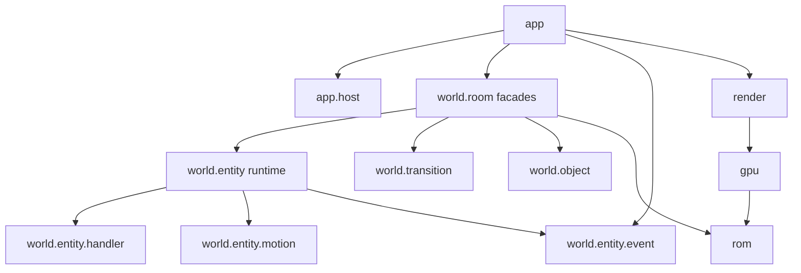

# Architecture

## Overview

This Java 21 / LWJGL engine reconstructs Link's Awakening DX for
preservation and research. Users provide their own ROM. ROMs and extracted
original assets must never enter commits, distributions, examples or fixtures.
Runtime graphics and world data come from that ROM.

The ROM and LADX disassembly are the technical sources of truth.
The simulation advances in 60 Hz frames and reconstructs ROM state machines,
rather than running a general Game Boy CPU emulator.
Byte-sized counters, slot ordering, intentional offsets and input edges are
observable behavior. A refactor must preserve them without behavior changes.
Replay checkpoints and emulator comparisons establish bounded fidelity;
a passing test suite does not establish game-wide parity.

`Main` is the entry point; `GameSession` owns a running session.
Hosts supply native input, presentation and PCM output. Headless execution
uses the same session simulation with a different host.
See [BUILDING.md](BUILDING.md) for setup and local ROM configuration.

## Design rules

Use composition for implementation reuse. A main-source class may extend a
JDK/framework type, or participate in a sealed hierarchy used polymorphically.
Do not divide one object's implementation into a linear superclass chain.
A collaborator owns its private state, receives the dependencies it actually
uses, and has a responsibility that can be tested independently. Pass shared
mutable data through small explicit state objects; do not share protected fields
or give file-slice helpers the owner's complete state.

There is no file-length or parameter-count target. Cohesion takes priority:
merge artificial slices and split only at a real responsibility boundary with
independent state. Moving methods into another file is not a design improvement.
Stateless algorithms and immutable table data are valid separate responsibilities
when their inputs describe that work rather than an owning object.

`architecture.NoImplementationInheritanceTest` checks superclass and sealed
permits metadata in every main class file. Owned packages have no exceptions.
Its temporary allow-list is empty repo-wide. The field inventories,
responsibilities and measured before/after sizes are recorded in
[composition-redesign.md](archive/history/composition-redesign.md).

Use explicit imports in main and tests, and import JDK types instead of inline
fully-qualified names. Diagnostics use DebugLog; direct console output is reserved
for CLI usage. Test-only inspection belongs in test fixtures.
OwnedSourceHygieneTest protects explicit imports and the absence of runtime
ForTest hooks.

Required collaborator fields are final and non-null. Validate them once with
`Objects.requireNonNull` at construction; update and render paths must not check
those dependencies again. Choose explicit no-op services or inert data at wiring
time for disabled audio, open-world collision, empty equipment and overlay-only
presentation. Missing player state, input, ROM tables or renderers are not domain
states. Test builders such as `testing.TestLinks` supply real lightweight services
or those same explicit no-op configurations, rather than passing null.

When an external caller still needs a legacy nullable constructor, retain a thin
adapter that selects defaults once and delegates to the validated form. Do not
store nullable services or spread compatibility branches through frame methods.
Runtime observer subscriptions and selected playback identities are mutable
configuration/domain data, separate from the required service graph.

Represent genuine domain absence with a named empty value, a presence flag or a
named predicate, and document it on the field or value type. Examples include an
unbound room, an inactive effect slot, a scene without per-line scroll, and a save
image without a disk destination. Preserve nullable public data accessors only
where external callers still depend on that contract; keep the translation at
that boundary. Do not introduce `Optional` or allocating wrappers in per-frame
paths. Initialize caches during construction where order permits; otherwise model
loading/publication phases explicitly, as with unloaded/running intro playback.
See [the non-null collaborator audit](archive/history/non-null-collaborators.md)
for remaining domain/boundary checks and constructor hand-offs.

## Package map

All names below are relative to `linksawakening` under
`java/src/main/java`. Subpackages own implementation responsibilities;
package placement does not imply that every pair is independent.

### `app`

The root contains `GameSession`, the public `HeadlessGameDriver` entry point,
`LaunchOptions` and `FramePacer`. `GameSession` owns one desktop/headless frame loop and delegates to the
objects built by `app.wiring.SessionWiring`.

| Package | Responsibility |
| --- | --- |
| `app` | Session and replay entry points |
| `app.wiring` | Composition root, subsystem factories and equipment target adapters |
| `app.services` | `SessionServices` and its seven subsystem bundles |
| `app.state` | Mutable screen, scene, clock, story, input, debug, save and stop state |
| `app.flow` | Navigation, persistence, shutdown and the completed session graph |
| `app.input` | Host/headless keys, queued gameplay routing and input completion |
| `app.audio` | Music selection and dialog-sound routing |
| `app.presentation` | Frame-state assembly, composition and debug-overlay ordering |
| `app.headless` | Diagnostic/checkpoint contracts and their owned snapshots |
| `app.host` | Desktop/headless resources and native boundary |
| `app.screen` | Five screens, their lifecycle ports and retained screen set |
| `app.gameplay` | Ordered phases, transition/input gates and borrowed input registers |
| `app.gameplay.entity` | Entity frame inputs, ordered result application and Link command adapters |
| `app.gameplay.interaction` | Bushes, lifting, dialogs and their input gates |
| `app.gameplay.recovery` | Pass-out animation, game-over presentation and recovery |
| `app.story` | Opening-story state machines and music/restoration ports |
| `app.debug` | Eager editor/overlay ownership, teleportation and logging |

`SessionWiring` runs once. `SubsystemWiring` builds ROM-backed services through
`RomWiring`, `AudioWiring`, `UiWiring`, `WorldWiring` and `PlayerWiring` in dependency
order. `EquipmentWiring` owns equipment construction and room target adapters
in the original registration order; construction-only parameter records remain
nested in their factories. `GameplayWiring`, `FlowWiring`
and `ScreenWiring` connect the retained application controllers and screens.

`SessionServices` contains `RomServices`, `AudioServices`, `InputServices`,
`WorldServices`, `PlayerServices`, `UiServices` and `VisualServices`.
Collaborators receive the bundles or components they use. `SessionContext` is an
immutable composition result containing services, state, frame-loop entry points,
host and stop state. `FrameLoopServices` groups screens, presentation, key dispatch,
shutdown, controllers and save storage. `SessionControllers` exposes the retained
domain controllers for delegation and headless setup. These records own neither
behavior nor functional callback fields.

`SessionState` groups live mutable holders. `FrameClock` owns the wrapping frame
byte; `OpeningStoryState` owns wake-up/shield motions; `GameplaySounds` owns the
replaceable sound sink. `SceneState` owns background maps and palettes.
`ScreenState` owns the current screen, file-menu/save operation states and save slot.
`FileMenuState` and `FileSaveState` select inactive or controller-backed operations.
`DebugState` owns no-clip; `DebugTools` owns its eagerly constructed menu/overlay.
Input/presentation gates still decide when they open and draw. `GameplayInputState`
tracks consumed input, `SessionOptions` holds live configuration, `SaveState`
owns replaceable storage, and `RunState` handles stop requests. Headless setup
uses typed accessors rather than reflection into private session fields.

The enforceable construction rule is: only `app.wiring` constructs collaborators
**across app domains**, where a domain is the first subpackage under `app`.
Domain-local helpers may construct each other; state/service values, entry types
and diagnostic snapshots are exempt. For example, gameplay phases own their
local adapters and recovery presentations, while wiring connects gameplay to
input, screens and audio. `app.gameplay`, `app.screen` and `app.story` cannot
reference wiring. Only `app.host` may reference LWJGL. Top-level `gameplay` cannot
depend on any `app` type. `architecture.AppPackageTest` checks these rules through
the shared class-file reader, including constructor method references.

Consumer-owned ports express cross-domain dependencies: `ScreenNavigator`,
`SaveActions`, `SessionLifecycle`, `InputCompletion`, `GameplayScreenDriver`,
`MusicRequests`, `DialogSoundRouting`, `DialogBlockers`, `GameOverActions` and
`DebugScroll`. `SessionNavigator` is the sole two-phase attachment: create it
before ROM/UI/world wiring, then attach screens, routes and room-music selection
once before publishing the session. `OpeningRestoration` remains for ordered
save-restoration fakes. `GameplayFrame.Transitions`/`Simulation`,
`SimulationStages`, `EntityFrameStages`, `EntityDialogRouting` and
`LinkMotionDriver` retain recording fakes for ordering checks. `Host` and `Screen`
have multiple implementations. The former local `DebugActions` and
`TeleportTarget` interfaces had no cycle or fake and were removed.
Legacy UI/host callback adaptation creates no session back-call fields; debug
editor bindings still use functional reads/writes for editable values.

`GameOverFlow`, `DialogBlockerPolicy`, `DebugTeleporter`, `SessionInput`,
`FramePresentation` and `SessionShutdown` own their respective behavior.
Required service references are validated at construction. Opening-story presence remains confined to its lifecycle owner. Closed menus and
death/game-over sequences use explicit inactive/active states; absent selected
swords are equipment-domain values.

`HeadlessGameDriver` retains its public input/stepping API. Its nested `State`
and `Diagnostics` implement the `HeadlessState` and `SessionDiagnostics`
contracts and compose `ReplayCheckpoint` and `SessionDiagnosticSnapshot`.
The checkpoint owns its values, equality, hashing and text format. Diagnostics
retain live views with the captured frame number. These are composed public
entry names, with no implementation superclass or separate value-method slice.
Three **test-source** forwarding helpers preserve old static names used by tests
outside the app ownership boundary; they add no production entry types.

App/gameplay classes document their role and lifetime and follow the composition
and cohesion rules above. Per-frame orchestration retains its collaborators;
headless diagnostic snapshots are constructed only when requested.

### `app.screen`

`Screen` implementations own title, cutscene, file-menu, file-save and gameplay
lifecycle. `app.input.GameplayScreenAdapter` connects gameplay to input
interception, the retained frame runner and recovery presentation.
`GameplayScreen` retains primitive key buffers: queued edges are detached before
dispatch, new edges wait for the next frame, and save interception discards the
pending batch. Input completion still happens only at its original frame gate.

### `app.gameplay`

`GameplaySimulation`, its phase instances, `GameplayFrame` and `TransitionPhase`
are built once. Phases read live state through simulation accessors.
`GameplayFrame.tick()` runs transitions, simulation and input completion;
`SimulationStages` preserves story/recovery early exits. `EntityFrameStages`
ticks the world and then applies results in their original order, passing the
same sword box and projectile events through consumers without dispatch-list
or closure allocation.

In `app.gameplay.entity`, `EntityFrameInputsFactory.borrow()` fills retained
read-only EntityFrameValues for synchronous ticking; `create()` returns an owned
immutable EntityFrameInputs snapshot. Its unchanged player/UI/button/sword leaves
are shared safely through EntityInputCache. FrameInputCache owns borrowed combat,
pickup and ground registers; their consumers finish before the next refill.
`LinkWriteApplier` translates ordered Link requests, `EntityRewardApplier` drains
synchronous reward batches, and `GameplayCombatEvents` implements damage outcomes
and the room combat drain. `LinkCommandAdapter` is the world-to-Link command
translation boundary. The world tick itself remains world-owned.

`LinkEquipmentPhase` retains `ActiveLinkPhase` for lifting, equipment, motion,
doors, pickup and transition work; `LinkGroundPhase` preserves pre/post-motion
ground sampling. Interaction policy lives in `app.gameplay.interaction`, including
`LiftButtons` for edge/B-slot priority. Pass-out animation and game-over dispatch
live in `app.gameplay.recovery`. `app.wiring.RoomBombPlacement` adapts successful
bomb placement to Link's animation write.

### `app.story`

`OpeningStory` reads live clock/motion holders from `app.state` and delegates music
through `MusicRequests`. `OpeningActions` names its dependencies;
`OpeningRestoration` names the ordered save-restoration operations.

### `audio`

ROM sequencing, deterministic synthesis, pure sample transport and host output.
Only `audio.openal` may reference LWJGL. Browser models are headless.
Key types: MusicDriver, MusicVoiceEmitter, GameBoyApu, FrameAudioMixer, OpenAlStream.
The APU diagnostic tap normalizes absence to a no-op observer.

### `config`

Application configuration and launch preferences through a strict JSON reader.
Malformed JSON fails with a source position; no JSON dependency is required.
Key types: AppConfig, MiniJson.

### `cutscene`

Scripted intro orchestration and ROM-backed intro data.
Key types: CutsceneManager, IntroSequence, IntroRomData, IntroBeachActors,
IntroWater, IntroSpriteComposer and IntroFramePublisher.

IntroSequence is a final stage orchestrator. Beach actors own positions and
motion timers; water owns wave fractions and offsets. Sprite composition owns
its decoded tables, scratch lists and RNG, preserving original call order.
Frame publication owns palettes, delayed scene snapshots and its retained
builder. IntroPhaseState, IntroClock and IntroVideoMemory are small explicit
state objects for shared stage, time and hardware-map/scroll data. Palette
arithmetic and default-ROM construction have separate, stateless responsibilities.

Entry points accept Rom; unused byte-array compatibility delegates are removed.
IntroRomData preserves its defensive copy and format bounds. Pre-update snapshot
timing, frame counters and immutable published copies retain their original
semantics; no collaborator receives the IntroSequence owner.

### `dialog`

Dialog state, ROM text layout, font and box rendering.
Key types: DialogController, DialogText, DialogRomLayout and DialogRenderer.

DialogController owns the cohesive reveal/scroll/choice state machine and
queued sound requests. DialogText owns name substitution and width-dependent
layout, independently of dialog timing. Both are final and own private state;
the former lifecycle/paging/formatting superclass layers are removed.
Input edges, reveal timing, scrolling, selection and sound order are preserved.
Font/layout readers use typed Rom values. Sound consumption reuses immutable
single-event lists and copies multiple-event lists to preserve retention.
ROM-free allocation guards exercise printing ticks and sound consumption.
Glyph bytes and visible-page layout are cached; unchanged visible text is reused.

### `entity`

Link composition, motion, commands and shared sprite definitions.
Room entity simulation lives in world.entity.
Key types: Link, LinkAssembly, LinkRoles, LinkPositionRole, LinkMotionRole,
LinkAnimationRole, LinkActionsRole, LinkStatusRole and EntitySpriteCatalog.

Link is a final aggregate with direct retained role accessors and no superclass.
Nine narrow interfaces expose position, motion, animation, actions, status,
equipment, airborne motion, side-view motion and controls. Their implementations
receive components, never Link. LinkAssembly binds cyclic component references
once before publication. Update delegates to the retained motion orchestration;
the motion command role also coordinates aggregate debug reset. The world route
fixture binds Roc's Feather to the airborne role directly; the remaining
JumpTarget adapter stays within that component owner's scope.

LinkStateMachine dispatches frame phases and composes LinkDash, LinkRoomPhysics
and LinkDoorTraversal. They own charge/rebound/shake, room defaults and door
traversal respectively. LinkMotionStatus contains explicit shared mode/recovery
gates. LinkMotion composes LinkPosition for XY subpixels, speeds and position
shadows, plus LinkCollisionState for probe/mask/door-warp state. LinkAirborne
owns jump/landing orchestration, LinkPitFall owns pit probing and fall timing,
and LinkElevation is their explicit height/speed state. These state fields are
private; no implementation superclass remains.

LinkAnimator owns pose selection and scripted presentations. LinkSpriteComposer
receives selected pose values and owns body tile composition/equipment draw
order; LinkPoseTables holds fallback data. Animation facing is Direction;
Java/ROM conversions are explicit. Raw snapshots and permissive equipment
boundaries retain their integer representation and documented fallback behavior.

EntitySpriteHandlerCatalog composes immutable registration recipes, their
context-sensitive lookup and bounded ROM decoding. EntitySpriteRegistrationData
owns the family recipe selectors and indexes EntitySpriteRecipe values once;
there are no stateless per-family forwarding files. EntitySpriteDecoder owns ROM access. BossSpriteComposer, EntitySpriteStates
and EntityEffectSprites own boss geometry, state-dependent selection and transient
effect composition; EntitySpriteGeometry supplies pure OAM coordinate algorithms.
First-match priority, map-byte selectors, bank bounds and palette/tile-source
choices remain unchanged. EntitySpriteCatalog passes Rom directly to the
world-owned RoomPaletteLoader. ROM-free allocation guards cover walking with
repeated sword swings.

### `equipment`

Equipped item behavior, activation and item sprite support.
Key types: EquipmentController, EquipmentItem, ItemRegistry, Sword, SwordSpin,
SwordRenderer and SwordPalette.

Sword is a final swing/charge orchestrator with private animation and movement
state. SwordSpin independently owns queued-start delay, spin frames, sector and
base direction; it returns pose values and never receives Sword or its state.
The existing renderer and palette objects handle blade presentation. Themed
SwordTables and EquipmentTables retain ROM lookup boundaries. Primitive frame
counters, held/input-edge priority and sound/RNG ordering are preserved.
Owned player and Link callers use composed APIs. Sprite/palette loaders accept
Rom; unused byte-array delegates are removed. Timing inspection fixtures live
in tests rather than ForTest members in runtime classes.

### `gameplay`

Gameplay integration contracts, dialog interactions, sound routing and event consumers.
Key types: EnemyCombatEventConsumer, EnemyProjectileEventConsumer, PcmSoundOutput.

Owned consumers address focused PlayerState components. The sound boundary
adapts resource requests to presentation events through PlayerSounds; PlayerState
has no gameplay sound compatibility bridge. Signpost
interaction uses its seven-argument entry point and `Interaction` bundle.
`DamageConsequences` names the contact-hurt and power-up-ended effects requested
by projectile consumption. Its app implementor is retained; the older callback
parameter overloads remain for compatibility tests.

`DialogTextLoader`, `SignpostDialogTable` and ROM-backed sound construction accept
`Rom`. Dialog text retains its owned snapshot and bounds behavior; its unused
byte-array bridge is deleted. App passes `Rom` through all construction paths,
including the five former world wiring byte handoffs. Their deprecated overloads
are deleted after migration of main and test clients.

App/gameplay main and test callers use PlayerState's component APIs and Link's
composed roles, including bound method references. Production Link construction uses
`LinkDependencies`, and Roc's Feather targets the airborne role directly. No owned
caller depends on the deprecated inheritance bridges; a full temporary
`-Xlint:deprecation,removal` compile reports zero owned removal warnings.
State enum values replace deprecated inventory, tunic, power-up and direction
constants, with explicit ROM/engine index conversion at integer boundaries.

### `gpu`

VRAM, tile decoding, animation and named ROM tile loaders behind the GPU facade.
Key types: GPU, Vram, AnimatedTiles, RoomTileLoader.

### `input`

Native-free bindings and held/edge state with stable numeric engine key codes.
DesktopHost translates GLFW actions at the callback boundary; edge ordering is unchanged.
Key types: InputConfig, InputState, KeyCodes.

### `physics`

Room collision queries and physical flags.
Key types: OverworldCollision and PhysicsFlags.

OverworldCollision retains themed PhysicsTables and CollisionTables from its
existing injection boundary. Object-grid ownership, bounds, sub-pixel arithmetic
and source collision ordering are unchanged. Immutable ground samples are reused
per cell and replaced when object or physics values change. Physics remains input-free,
enforced by StateDependencyTest.

### `render`

Frame scenes, indexed planes, OAM submission, hardware composition and GL presentation.
Key types: FrameScene, HardwareFrame, OamSink, OpenGlFramePresenter.
HardwareFrame normalizes absent diagnostics to a no-op observer; inspection uses that same non-null observer contract. Dialog layers normalize an omitted
painter to the ROM-backed implementation. GameFrameState documents which
screen-specific components may be absent. Layers retain their mutable frame
configuration and scratch; publication snapshots retain ownership.

### `rom`

Typed ROM addresses, symbols, bank mapping and shared tables.
Key types: Rom, RomAddress, RomSymbols, GbcBanks.

Rom construction uses validated `of` or explicitly alignment-unchecked
`unchecked`; its constructor is private. Tests use `TestRoms.partial` for
synthetic buffers. RomTables exposes themed table holders only: all deprecated
aggregate methods and RomUtil delegates are removed. The five app wiring byte
handoffs are migrated, and no backing-array escape hatch remains. Shared storage,
partial-buffer validation timing and read bounds are unchanged.

### `save`

Source-shaped SRAM layout, image operations, player-field codec and host persistence.
Wrong-sized saves are copied to timestamped corrupt backups before initialization.
Persistence writes a complete temporary image then replaces the destination atomically
where supported, with a replacement-move fallback.
Key types: SaveRamStore, SaveRamLayout, SaveRamImage, SaveSlotCodec, SaveSlotState.

### `scene`

ROM-backed background scene catalog and loading.
Key types: BackgroundSceneLoader, BackgroundSceneSpec and BackgroundSceneCatalog.

BackgroundSceneLoader retains Rom and uses typed draw-command and palette
readers. Scene-specification address conversion retains the legacy file-offset
semantics, including CPU-window aliases. Partial attrmap writes preserve selection-screen state for file copy
and erase scenes. The unused byte-array constructor is removed. Intro and menu
controllers own presentation state.

### `startup`

New-game profiles and wake-up/shield motion state machines.
Key types: StartupCoordinator, NewGameStartProfile, MarinWakeUpMotion and TarinShieldMotion.

Startup calls PlayerState components and Link roles while preserving the
opening-motion timers and presentation order. Marin and Tarin reuse immutable
pose values so retained results cannot change on subsequent ticks. NewGameStartProfile supplies a
named builder alongside its deprecated canonical constructor.

### `state`

Player resources, progression, ROM value types and save-value application.
Key types: PlayerState, Inventory, Vitals, Ammunition, Progression, Wallet,
EquipmentLevels, PlayerInitialization, PlayerSaveLoader and ResourceSound.

PlayerState is a final aggregate with no superclass or deprecated members. It
owns and directly exposes its components. The former LinkPlayerState interface
and all PlayerState compatibility layers have been deleted; Link behavior
addresses the components directly.
The external migration work list is in
[link-player-api-migration.md](archive/history/link-player-api-migration.md).

Initialization and save loading preserve write order and raw saved inventory
bytes. Reward components accept state-owned values without world dependencies.
Resource sounds are last-write-wins values mapped by the presentation consumer.
StateDependencyTest enforces the state/rom/save boundary without exceptions and
also checks that physics remains input-free. Composition guards require both
aggregates to extend Object directly; the class-file inheritance guard applies
the same composition rule to all main packages.

### `ui`

Inventory, HUD and file-menu controllers and overlays.
Key types: InventoryController, InventoryMenu, HudOverlay, FileMenuController,
FileNameEntry and TilemapRenderer.

Inventory rendering and synchronous HardwareFrame submission reuse tile and
attribute scratch buffers. Numeric and palette pairs use primitive values;
region/row arguments are retained. Published closed-window snapshots still own
independent arrays. Inventory context is copied only when contents change.
ROM-free guards cover the fully open HUD/inventory update
and submission path, including snapshot retention checks.

UI ROM readers accept Rom. FileMenuRomData preserves its defensive copy,
including support for legacy partial synthetic buffers. FileMenuController
owns slot/copy/erase transitions and frame publication; its FileNameEntry
collaborator owns character selection, insertion position and name bytes. Both
are final with private state. Published frame snapshots remain immutable and
use retained builders. OcarinaSong supplies typed flag and selection conversions.

### `vfx`

Transient effects, source-shaped lifecycles and ROM-backed effect sprites.
Key types: TransientVfxSystem and TransientVfxSpriteSheet.

Effect iteration retains source order. Sprite loading accepts Rom. A live read-only
slot view supports immediate consumption; activeSlots retains owned snapshot
semantics for captures. Published placement lists
retain independent ownership; mutable scratch storage is used only where
consumed synchronously.

### `world`

World ownership namespace partitioned into rooms, transitions, objects and entities. No direct app dependency is allowed.
Key types: room, transition, object, entity.

### `world.room`

Room facade, decoded room state, loading, palettes, tilemaps, mutations and entity integration.
Key types: RoomSession, RoomSessionContext, RoomLoadCoordinator, RoomObjectMutations.

### `world.transition`

Boundary decisions, scrolling, warps and transition progression.
Key types: RoomBoundaryController, ScrollController, TransitionController, Warp.

### `world.object`

Object-specific interactions and switch-block behavior.
Key types: OverworldBushInteraction, BombObjectInteraction, SwitchBlockAnimation.

### `world.entity`

ROM slot orchestration, owned state, scoped controller services, collision and frame requests.
Key types: RoomEntityRuntime, EntityMotionRegistry, EntityPhysicsTables, EntityCombatTables, EntityFrameExecution.

### `world.entity.handler`

Explicit type registration and ordered dispatch-site callbacks, internal to entity simulation. Handlers do not depend on world.room.
Key types: EntityHandlerFamilies, BombHandler, RoamingEnemyTypeHandler.

### `world.entity.motion`

Entity-owned slot state and state-machine calculations, acquired through the typed motion registry.
Key types: BombMotion, MoldormMotion, FollowingNpcMotion.

### `world.entity.event`

Value events and requests exchanged across the entity boundary.
Key types: EntityEvent, EntityRequest, EntityCombatEventBuilder, DialogRequest, LinkFinalPositionRequest.

### Dependency boundaries

Arrows show permitted use across the principal boundaries, not every import.
The app uses an explicit world facade allow-list and event contracts.
Handlers and motion remain internal to world.entity.



`ClassFileReferences` in `java/src/test/java/linksawakening/architecture`
reads symbolic constant-pool references, including descriptors, generic
signatures and field references. `WorldDependencyTest` uses this shared reader.
It rejects world-to-app references, handler-to-room references and external
use of motion/handlers, and checks the explicit app/world facade surface.
Event dependencies must be event contracts or record/enum values. The app
allow-list names the used role views, boundary records and construction/resource
facades. A second rule applies the same boundary to every non-world main client,
with explicit stable sprite/OAM/physics contracts. A visibility check scans
main and test constant pools: a public top-level world type needs a cross-package
client or an explicit public-contract entry. Other implementation types stay
package-private; Java subpackages still require public cross-package entity
services. The reader accepts both main and test class roots.
`AppBoundaryTest` checks entry-point/session ownership, screen lifecycle types,
native dependency restrictions and the canonical bomb-placement role API. It also
rejects session/composition references from domain collaborators and checks named boundary parameter objects. Structural class inspection never reads private runtime state.
`GameplayFrameOrderTest`, `SimulationOrderTest`, `EntityFrameOrderTest` and
`EntityFrameSessionTest` observe lifecycle order, early exits and consumer
side effects. `RoomLinkWritesTest` checks descending merges and tie precedence;
Link command and bomb-placement tests check real player/Link effects.
`FileMenuBehaviorTest` exercises persistence, room entry and opening-story gates
in headless sessions. None shells out to `javap` or matches disassembly text.
The complete old-to-new mapping is recorded in
[the architecture-test migration](archive/history/room-architecture-test-migration.md).
`GlBoundaryTest` in `java/src/test/java/linksawakening/render` scans compiled
gpu/render classes: only presenter classes may reference LWJGL there.
These are specific guardrails, not a universal acyclic-package rule.

## Frame lifecycle

`Host.pollEvents()` delivers keys to `SessionInput`, which handles an open debug
menu before `InputRouter`. An open debug menu pauses the update, including audio
and RNG advancement. Ordinary screen input retains its original edge ownership.
`GameSession.update()` advances `FrameClock` modulo 256 and begins the
ROM random frame, then ticks `MusicDirector` before ticking the active screen.
Thus sound requests produced during simulation are sequenced after this
frame's audio advance; moving audio after entities changes timing.

For gameplay, `GameplayFrame` executes TRANSITIONS, SIMULATION and
INPUT_COMPLETION in that order. Simulation can return early at story gates;
normal completion still advances input edges. `FrameInputCompletion` ticks edges
before clearing the consumed-input flag. Exceptions do not advance them.
`GameplaySimulation` runs dialog/story, Link/equipment, combat, entities,
dialog gameplay cooldown and animated tiles in source order.
Scrolling, transitions and inventory state gate entity ticking.

The runtime iterates slots from highest index to zero. Each slot passes five named methods in EntitySlotPipeline; a phase can end that slot's work.
`app.gameplay.entity.EntityPhase` borrows read-only `EntityFrameValues` from Link, player,
UI, buttons and sword-box snapshots through `EntityFrameInputsFactory`.
`LinkWriteApplier` applies ordered Link effects while `EntityPhase` orchestrates
combat and presentation and delegates rewards to `EntityRewardApplier`.
`RoomSession.tickEntities` composes `RoomFrameInputApplier`, which applies inputs
in the original setter order before advancing entity slots. The input port also supplies EntityTickValues directly, without allocating a tick wrapper.
`EntityTickInputs` is the tick-only boundary for callers that retain cached
inputs; combat and pickup boundaries use their own parameter objects.
Entity effects are consumed at the entity boundary, including projectiles,
combat, rewards, dialog and music requests. Link writes become `LinkCommand`
values through `LinkCommandAdapter` and are applied through `Link.apply`.
Competing Link writes retain descending source-slot ordering. `RoomLinkWrites`
merges position streams with pot/platform/final-position tie precedence and
attack streams with attack-step precedence on ties. These are separate
consumption stages: a platform write can load a room before later outputs
are drained. `EntityFrameResults` groups live outbox views by Link, rewards
and presentation. The facade caches these live views; it does not eagerly
snapshot every channel. Synchronous `LinkWriteSink` visitors drain every competing
stream before applying any merged write. Reward and combat `RoomFrameDrain`
callbacks receive reusable read-only batches valid only during the callback;
queue clearing still precedes consumer effects. Snapshot-returning `consume`
methods remain immutable for clients that retain results. The dialog boundary
drains all requests before selecting the first one to open.

After simulation, `FramePresentation` asks `RenderStateAssembler` for scene
composition and then overlays the optional debug menu. The assembler refills
one `GameFrameState` for scene construction, without intermediate copies. Indexed layers and OAM entries feed hardware composition.
`FrameScene` composes RGBA, and the host presents the resulting pixels.
Desktop pacing is owned by `FramePacer`, after update, composition and presentation.
It carries the remainder of one billion nanoseconds divided by 60, parks until
100 microseconds before the deadline, then uses a short spin. Each wakeup rereads
the monotonic clock. Overruns retain pending deadlines, so elapsed simulation
steps are caught up rather than discarded. Interruption exits pacing without
clearing the interrupt. GLFW swap interval is zero: refresh-rate blocking must
not establish a second cadence. Fake-clock tests cover drift, oversleep,
spurious wakeups, catch-up, interruption and nanosecond-clock wraparound. Native
presentation was not opened for this refactor. OpenAL retains its three-frame
prefill, underrun recovery and queue-pressure rebuffering policy.

Headless stepping is unpaced and composes the same framebuffer without a native
window. `headlessFrame()` still returns an owned capture; the retained-output
`headlessFrame(byte[])` overload runs the same full path and copies pixels into
caller-owned storage. `WholeFrameAllocationTest` measures that full overload,
including simulation, assembly, scene build and composition, after reaching
opening-dialog idle, house walking with entities, and open inventory by ordinary
input. This avoids counting the separate allocation required for a new owned
capture buffer. Pixel tests compare both capture APIs and compare the running
borrowed renderer with owned reference scenes through inventory transitions.

`RenderStateAssembler` retains one `GameFrameState`, refills it from the
same live collaborators and screen overrides, then uses the reusable scene
builder. Its room is `rooms().renderViewOrNull()`; indexed room planes are copied into
retained renderer buffers without allocating. The common render contract is
`RoomRenderView`, implemented by immutable `RoomRenderSnapshot` and live views.
`currentGameFrameState()` returns the retained borrowed inputs; test-only FrameSnapshots creates owned reference inputs. The
world's `dungeon().view().copyTo(...)` fills retained eight/five/64-byte inventory
buffers; UI setters retain their original copying contracts. Historical scroll
rooms continue to use owned snapshots.

With escape analysis disabled, whole-frame idle/walking/inventory measure
0 / approximately 139.5 / 0 B/frame. Update-only idle/active measure 0 / 137.
Their budgets are 0/175/0 and 0/172 respectively. Reusable assembly, construction
and representative VFX composition measure zero. Recording disabled contributes
no steady frame allocation. EntityFrameContext and its LinkState remain immutable
because public EntityHandler callbacks may retain them. See
[frame-input-allocation.md](archive/history/frame-input-allocation.md) for ownership
and bisection, and [TESTING.md](TESTING.md#performance-budget) for all guard scopes.
These measurements and scene parity are bounded regression evidence.

```mermaid
sequenceDiagram
  participant H as Host
  participant S as GameSession
  participant A as MusicDirector
  participant G as GameplayFrame
  participant E as RoomEntityRuntime
  participant L as Link
  participant R as RenderStateAssembler / FrameScene
  H->>S: poll events / route input
  S->>A: tick audio
  S->>G: tick active gameplay screen
  G->>G: transitions
  G->>L: dialog/story then Link/equipment
  G->>G: combat
  G->>E: entity frame inputs
  loop descending slots
    E->>E: phases 1 through 5 / handler stages
  end
  E-->>G: outbox events and requests
  G->>L: adapt and apply LinkCommand
  G->>G: consume rewards/dialog/music; cooldown; tiles
  G->>G: complete input edges
  S->>R: assemble and compose hardware frame
  R-->>H: RGBA pixels for presentation
```

## Entity system

`RoomEntityRuntime` is the source-compatible room facade and the single
composition root. It constructs shared state first, then concrete controllers
in dependency order. There are no lazy service bindings or suppliers of the
runtime. `EntityRuntimeState` composes cross-cutting slot, combat, physics,
room and presentation data; neither class inherits fields or constants.
`EntityRomConstants` is a final, non-instantiable holder used directly by callers.

Per-type state belongs to its motion or encounter. State needed by both an
inspector/reset path and a behavior controller has an independent owner:
bomb, projectile, lift, pickup, reward, story, boss and slot-presentation state,
plus Genie and Slime Eye encounter state. This breaks construction cycles
without exposing a partially constructed controller. Controllers receive final,
validated concrete dependencies. `RoomEntityRuntime.builder(snapshot)` selects
explicit ROM-backed or ROM-free policies during construction. Room loading and
follower synchronization supply the real RNG, sprite catalog, combat tables,
chest table and ROM readers. The ROM-free fixture supplies deterministic RNG
and uses the runtime's named collision/query defaults. Execution does not test
collaborators for null. Legacy nullable inputs are normalized at their construction/configuration
boundary, retaining the old public contracts.

| Dependency | Explicit absent-input policy |
| --- | --- |
| Boolean background / object collision | `RoomEntityBackgroundCollision.OPEN` / `RoomEntityObjectCollision.NONE` never block |
| Rich background interaction | `RoomEntityBackgroundInteraction.NONE` returns a shared no-collision result |
| Ground interaction | `RoomEntityGroundInteraction.NONE` returns the entity unchanged with ground status zero |
| Object sampling | `RoomEntityObjectQuery.NONE` returns `RoomEntityObjectSample.UNSAMPLED`; a genuinely sampled `$FF` cell is still distinguishable |
| Sprite catalog | `EntitySpriteViews` selects a ROM source or an unsupported source; unsupported presentation preserves the entity and its variant |
| Combat tables | `RomEnemyCombatTables.DEFAULTS` preserves the old type-sensitive health/damage rules and disables Bow-Wow eating; ROM-dependent drop lookup retains its precondition |
| Chest table | `EntityChestContents.Empty` emits no presentation sound/dialog and retains the original error if a spawn requires ROM contents |
| Drop / warp policies | `EnemyDropResolver.NONE` performs no defeat bookkeeping or RNG reads; `WarpMotion.DISABLED` skips the original warp handler path |
| RNG | `EntityFrameRandom` selects an externally clocked source or the old room-owned ROM RNG; operations that required an explicitly supplied RNG retain that precondition |

Room geometry policies can still be replaced through configuration because room
consumers own their lifecycle. The physics owner always stores a non-null policy;
controllers keep final references to that owner. Frame preparation selects rich
versus boolean collision precedence once, using stable adapters. Some sprite
capability gates remain where the unsupported path historically skipped a spawn
or state change. They are behavior choices, not nullable-service checks.

Genuine optional domain values remain documented: an unspawned hookshot, an
unavailable tail/parent, follower history, saved-room flags, snapshot presentation
metadata, and optional attack overrides or emitted effects. Construction-time
validation/default selection is distinct from these values. The detailed
[null-contract audit and small-class review](../java/src/test/java/linksawakening/world/entity/README.md)
lists every class with remaining comparisons and the retained responsibilities.

One entity's motion, input records, state handlers and reusable scratch live
in its motion class. `EntityMotionRegistry` supplies one typed motion instance
per room through `get(MotionClass.class, MotionClass::new)`. Its one first-use
entry marker is checked inside the registry; callers never test for a missing
motion. Adding a motion does not add a field to central runtime state. Controllers likewise contain
their own behavior sequences and scratch. Scratch owners are final constructor
dependencies; invocation inputs and temporary results are reset and released.
A reentrant call uses a separate holder. Moldorm's tail snapshot cache stays
separate because it owns retained immutable projections of the history taps.
Combat gates, sword impact and Link-contact responses form one ordered sequence
inside `EntityCombatResolver`. Slime Eye half transitions belong to its encounter
controller, beside their integration and timer call sites.

`EntitySlotPipeline` contains frame preparation, five named phase methods and
presentation commit. The descending slot loop and every early return remain
visible in one place. `RoomEntity` remains an immutable record whose slot and
load order are ROM identity. Snapshot helpers combine related writes into one
replacement and reuse unchanged values where fresh identity is not required.
The persistent and non-persistent slot reset paths remain distinct. Do not
compact slots, sort by type, add resets on slot reuse or move RNG reads and
byte writes across their original execution points.

`EntityHandlerRegistry` has 256 type bindings for initialization, generic
advance and stage hooks. Family handlers register directly with this concrete
registry using explicit type IDs and named callbacks. Their initialization,
advance, tick hooks and nested scratch live together. The ordered
`EntityHandlerFamilies.INSTALLERS` list contains one registration line per
family; duplicate registrations fail and unsupported bindings remain explicit.
All bindings are allocated at registry construction, with named no-hook and
initializer-fallback actions; dispatch never depends on a null callback.

`EntityTickStage` describes 27 dispatch sites between phase operations. Each
site retains ordered visit positions, preserving all 141 original visits.
Dispatch reads the current slot type at each visit, so a hook that replaces or
transforms an entity affects subsequent selection in the original order.
A false callback stops the slot immediately. Enum order and numeric entity IDs
do not establish the schedule.

`EntityFrameContext` is immutable frame input. Use its builder or `toBuilder`
when changing Link state, collision inputs, RNG or interaction gates; referenced
services retain their identity. `EntityFrameExecution` owns nested frame-input,
timer-gate, slot-execution and presentation scratch, with no public mutable
fields. The runtime reuses one execution object. Acquisition resets frame
scratch, descending visits reset slot scratch, and the pipeline releases the
frame in a `finally` block. Reentrant frames use a separate execution object.
Stable collision adapters and typed state views retain their identities.

`EntityRoomInspection.snapshot()` captures an owned immutable copy for retained
state and consumers that require ownership. `view()` returns a cached read-only
live `RoomEntitySnapshot` for immediate same-thread consumption. Its lists and
metadata follow the runtime; it is not a historical frame or a cross-thread
snapshot. Both forms have a non-null data representation (`Owned` or `Live`),
rather than an optional live source checked by every accessor. A `withX`
operation on a live view materializes owned data first.
Moldorm tail presentation reuses immutable segment lists only while their
coordinates are unchanged. Projection caches and pickup sequence owners are
seeded eagerly. An explicit state distinguishes a pickup never collected from
one whose collection has completed. Hookshot outcomes and completed falling or
musical-note motion use named no-result values; optional emitted spawn/effect
requests remain nullable where that directly expresses the result without
per-frame allocation.

`EntityTickAllocationTest` measures a ROM-free six-entity mix: roaming enemies,
a projectile, active Moldorm, a droppable and an NPC, with three inspection
reads per tick. It retains inputs and repositions the same slots without
allocation while motion state and timers advance. Its 1,100-byte limit keeps
headroom over the steady-state result. Measure with escape analysis enabled
and disabled using temporary JVM arguments; do not commit runner configuration
changes. Changed immutable entities, motion results and emitted events still
allocate. Other entity, presentation and session allocation guards also apply.

Typed events and requests accumulate in the entity outbox. Room/app consumers
apply Link, progression, dialog, music and transient effects. Source slots
preserve multiple Link writes in a frame. Outbox channels are cached index-based
views; size, clear and append do not create iterators, predicates or wrappers
per tick. Draining returns an owned result. Event/request records remain
separate public value types because consumers outside the entity tree use them.
`EntityCombatEvent.builder` and `EntityProjectileEvent.builder` name optional
effects without positional argument lists.

Entity ROM readers accept `linksawakening.rom.Rom` and typed addresses/reads.
Collision and property queries use `CollisionTables` and `EntityPropertyTables`.
Room, entity and sprite catalogs share the typed session ROM. Room-status arrays
are mutable RAM state, not ROM buffers. Class and table comments name the
ported routines and original labels, including unnamed disassembly tables.

Use `RoomEntityRuntime.builder(snapshot)` for construction. Test-side
`EntityRuntimeFixture`, inspection fixtures and `RoomEntityBuilder` supply
real ROM-free state, explicit service defaults and focused setup. Tests remain
split by entity family and behavior. Room consumers use runtime/frame builders, `EntityPickupFrame`,
`EnemyCombatFrame`, `EntitySwordContactFrame` and `FollowingNpcSpawn`; the old
`from`, `ForTest` and wide operation adapters are removed. Preserve externally
used signatures when consolidating internal code. Cohesion determines class
boundaries; there is no file-length limit. Main and test imports are explicit.

To add an entity type:

1. Add its motion/state owner in `world.entity.motion`, preserving the
   disassembly's initialization, timers, byte arithmetic and RNG ordering.
   Keep its input values and execution scratch beside the behavior. Any new
   service must be required at construction or have a named absent-input policy
   that reproduces the established ROM-free behavior.
2. Add its family handler in `world.entity.handler`. Register initialization,
   advance and site/visit hooks with `EntityHandlerRegistry`, acquire the
   motion through the typed registry and emit typed events for external effects.
3. Add one `NewEntityHandler::install` entry to
   `EntityHandlerFamilies.INSTALLERS`.

Add focused behavior coverage with the fixtures and ROM-backed tables; never
add extracted assets. The required headless refactor oracle is
`LA_ROM=/path/to/user/rom ./gradlew spotlessApply test` from `java/`, including
its default session replays. Explicitly tagged `known-gap` routes are excluded
and are not refactor validation targets. Preserve consumer and sprite contracts
within the entity boundary.

## Rooms and world

`world.room.RoomSession` owns the loaded-room lifecycle through one
`LoadedRoomHandle`. Its optional `RoomRuntime` is absent before the first room
load; absence is never represented by a fake room or empty entity runtime.
Behavior owners resolve the current generation at their operation boundary and
preserve the no-room policy: cached/persistent writes still run, loaded effects
may be skipped, queries keep their original default or required-room exception.
The [operation matrix](archive/history/room-lifecycle.md#final-no-room-operation-matrix)
and [null audit](archive/history/room-null-audit.md) record those contracts.

`RoomRuntime` means one live generation, distinct from the existing `LoadedRoom`
owned decoded-ROM value. A generation has final non-null active room data,
entity runtime, collision scratch and callbacks bound to that generation.
Its `RoomContents` owns mutable room data, per-room puzzle counters/flags and
tile overrides. Loading prepares these contents before creating the entity
runtime, preserving door/shutter initialization order. Follower synchronization
can replace the entity runtime while retaining the same room contents. Room
installation publishes the generation; listener notification follows the
original configuration order. If a listener synchronously loads another room,
subsequent source-ordered load work uses the generation returned by the
notification callback. Warp palette history is sampled after map-boundary callbacks, as in the source sequence.
The loader invokes the wiring-bound transient reset at the original load phase,
including when subsequent room acquisition fails; the previous generation's
transient flags/overrides still clear before that error.

Role entry points use the explicit loaded-room handle. Loaded-only algorithms
receive a non-null generation or its specific parts as an operation argument;
they do not query ambient active-room/runtime suppliers. `RoomLocationState` and `RoomEntitySessionState` contain
no loaded-room aliases. Registers that survive room replacement, including the
Link ground registers, switch-block state, title/music clocks, progression,
follower inputs and session output queues, retain their distinct session/world
lifetimes. `RoomWorldState`, `RoomTransientState` and `RoomStoryState` own
persistent world data, reset sequences and story progression respectively.
A structural test prevents room/runtime aliases and current-value suppliers
from returning to session bags, outboxes or live projections.

The facade contains lifecycle publication/notification, `hasRoom()`, cached role/result
accessors and the two `tickEntities(...)` entry points. Both tick forms delegate
to RoomFrameInputApplier. No role routes behavioral operations through RoomSession,
and no main room implementation references its type. Publication and load
notification are explicit lifecycle callbacks, not operation forwarding or
current-value suppliers.

Roles are implemented by their behavior owners:

- `RoomDoors`: RoomDoorInteractions, composing chest and lift interactions.
- `RoomPlayerItems`: RoomPlayerItemActions, composing shovel behavior and projectile dispatch.
- `RoomTransitions`: RoomTransitionController, composing loading and boundary services;
  its coordinator factory supplies exact dependencies instead of inspecting a facade.
- `RoomStory`: RoomStoryState, composing remembered flags, NPC presentation and follower synchronization.
- `RoomRooms`: RoomLoadCoordinator, owning load commands and current-generation queries.
- `RoomDungeon`: RoomWorldState, owning persistent flags, snapshots and its retained minimap view.
- `RoomProgress`: RoomProgression, ordering respawn/reset operations across location,
  entity-drop and terrain state, then reapplying loaded drop configuration when required.
- `RoomTerrain`: RoomObjectMutations, owning cracked-floor and crystal mutations.
- `RoomEntities`: RoomEntityBridge, owning room/entity tick integration, combat,
  pickups and the outbox drain boundary.
- `RoomEntityState`: RoomEntityControl, composing input configuration, runtime
  control/inspection and their shared metadata owners rather than the facade.

RoomFrameInputApplier applies inputs in their original setter order, including
both low-health configuration steps, then invokes the entity owner. Tick registers
are observed through RoomFollowerState.observeLink, RoomEntitySessionState.observeMotionState
and RoomLocationState.beginEntityTick; the facade writes none of their fields.
RoomEntityInputs distinguishes remembered inputs from updates applied to a loaded
runtime. Output ports reference the entity owner directly, retaining drain order,
queue clearing, reentrancy and immutable ownership contracts.

RoomSessionComponents is a construction inventory used only by RoomSessionContext.
The wiring hands the facade role contracts, frame sequence/results and lifecycle
view support, never the inventory. Callbacks capture their specific state/handle,
not the wiring inventory. `architecture.RoomFacadeTest` checks symbolic class-file
references and class metadata: facade isolation, construction-inventory isolation,
public entry-point shape and absence of facade fields on role implementations.
Test-only RoomSessionInspection observes composed owners without adding production
inspection aliases or retaining a wiring bag. The [dependency report](archive/history/room-hub-removal.md)
lists every remaining facade method and main-code class-file reference.

Construction takes `RoomSessionConfig`, which validates required long-lived
collaborators once. Optional presentation outputs are normalized eagerly to a
zero-slot VFX system, zero-slot drop system or no-op load listener. A retained
feature flag preserves the original skip of entity VFX request-list production
when that output is disabled. No per-frame room holder or bound callback is
created. `RoomSessionContext` is private construction-time wiring, eager in
dependency order; runtime collaborators do not read through the composition root.
Map mutation and immediate redraw share an owner. See the earlier
[room simplification report](archive/history/room-simplification.md).

`rooms().activeRoomOrNull()`, `palettesOrNull()`, `renderViewOrNull()` and
`renderSnapshotOrNull()` explicitly expose absence before load. For required
room reads, use `hasRoom()` plus `rooms().requireActiveRoom()`; the latter retains
a required-room exception. App and render callers have migrated to these explicit
forms; the four older nullable role methods have been deleted.

Immediate entity reads use `EntityRoomInspection.view()` and the live
`ActiveRoom.entityView()`. Per-frame rendering uses `RoomRenderSnapshot.View`
and indexed room/dungeon projections. They are same-thread borrowed views,
valid until the next tick, room change or world mutation; never use them as
history or share them across threads. Render projections bind directly to their
generation. The cached dungeon projection remains stable and receives map
identity at publication, preserving retained-view updates without a supplier.
Public `ActiveRoom.entities()` and owned render snapshots retain immutable
history; a bounded eight-presentation cache avoids copying recurring poses.
Scroll transitions keep an owned previous-room snapshot.

Room wiring accepts `Rom` directly; no `unsafeBytes()` accessor or call remains.
Bounded `RomSlice` reads let audio retain shared read-only storage without
exposing the backing array or allocating an address per byte. Unaligned
synthetic/legacy input uses the supported unchecked factory; validation,
bounds and backing storage are preserved.

`EntityFrameInputs` composes Link, player, UI, button and sword values. Link
position, motion, ground and pickup probes each store only the raw integer
required by ROM numeric gates. Direction and motion classifications are derived,
with explicit absence for unknown motion states; no enum and raw field can
disagree. Closed selections use their existing enum APIs; saved inventory bytes
and flag-only projections retain their raw/boolean boundary contracts.
Inventory construction accepts `InventoryItem`, `Tunic` and `PowerUp`, retaining
saved raw item bytes and the original flag-only inputs. Known ocarina selectors
use `OcarinaSong`; unknown selections and song flags remain bytes. Entity ground
codes are a separate ROM domain from Link's `GroundStatus` (entity water is
`$02`), so they must not be converted by matching integer values.

`RoomLoadCoordinator` coordinates room loading; `RoomLoader` reads room streams,
`RoomObjectParser` owns decode scratch state, stream walking, macro expansion
and persisted-status patches, and `RoomTilemapBuilder` constructs tilemaps.
`RoomPaletteLoader` owns palette decoding. Pointer tables and tileset tables
retain bank/page selection rather than flattening ROM addressing. All internal
ROM parameters, fields and reads use `Rom` and typed addresses. The five former app wiring byte entry points and the unused palette byte
constructor are deleted; callers share the typed session `Rom`.
See [ROM_FORMAT_NOTES.md](ROM_FORMAT_NOTES.md) for stream and macro details.

`RoomTransitionCoordinator` and room transition collaborators connect room
changes to scrolling and transition state. `world.transition` owns boundary
and warp mechanics. Keep load timing, input blocking and transition progress
intact: a visually plausible destination alone does not verify a transition.

`RoomObjectMutations` and room redraw helpers coordinate object changes with
room representation. Door, puzzle and player-item collaborators implement
specific interactions; `world.object` contains object-specific behavior. Object
mutation, puzzle and door operations are kept together with their respective
owners, without file-size limits or stateless sequence slices.
Entity integration passes through room bridges, inputs and reward handling.
`RoomEntityBridge` coordinates ticking; `RoomEntitySimulation` owns the complete
configuration/tick/ordered-effects sequence,
`RoomEntityCombatBridge` handles combat/pickup integration and
`RoomEntityOutbox` owns queued outputs under the retained session state. The outbox contains no runtime supplier; lifecycle routing stays in RoomSession. Results expose grouped Link,
reward and presentation consumers. Link writes merge by descending source slot
with the established cross-stream tie precedence; the application applies the
ordered writes. Empty outbox drains and merges allocate zero bytes, guarded by
`RoomLiveBoundaryTest`. Nonempty owned-list drains copy before clearing; reusable
consumer drains retain their existing staged-clear and reentrancy behavior.

The room generation also owns a reusable RoomBoundaryView probe. Boundary decisions
consume it synchronously; RoomBoundaryState remains an owned immutable value.
Input ports expose raw dispatch bytes once, without duplicate enum storage.

Changing a visual tile alone is insufficient when collision or persistent room
status also changes.

## Rendering

[RENDERING.md](RENDERING.md) is the detailed compositor contract.
Software layers submit indexed BG/window pixels and OBJ entries.
`GPU` is a facade over VRAM, animation and ROM tile loaders.
`OpenGlFramePresenter` owns GL presentation; gameplay does not issue GL calls.
Hardware-only `FrameScene` composition produces RGBA once. Optional completed-frame
observers attach explicitly through the draw overload or session-local builder;
production performs no service lookup. RGBA callback scenes live in tests.

CGB OBJ-to-background/window composition uses color-zero transparency,
both priority flags and LCDC bit 0. OBJ-to-OBJ ordering currently retains the
emulator-validated legacy painter order. It does not yet implement the ROM's
dynamic OAM allocator. An 8x16 entry retains its original Y for both halves.
Dialog and inventory hiding operate on whole entries using ROM visibility rules.

The parity harness compares hardware output to a test-only RGBA reference.
Strict parity rejects unexplained differences; expected fixes require narrow
source and pixel evidence. Independent emulator fixtures remain necessary
because two engine implementations can share a mistake.
`RenderPipelineParityTest` and `SceneParityExtension` produce local reports in
`java/build/scene-parity`; `-PsceneParityProbe=true` records mismatch groups.
ROM-derived screenshots and reports containing assets remain local.

## Audio

See [audio-engine-guide.md](audio-engine-guide.md) for sequencing and synthesis.
Music and SFX drivers consume ROM data and write APU registers.
`GameBoyApu` synthesizes deterministic stereo PCM; output owns host playback.
The `audio.music`, `audio.sfx` and `audio.apu` subpackages keep these duties apart.
`audio.openal` provides native playback and `audio.browser` the Swing audition UI.

The session uses `FrameAudioPlayer` with host-created `PcmSoundOutput`.
`MusicDirector.tick()` advances it once per game frame. Sample remainders
preserve long-term sample totals. Dialog and gameplay effect routing share the
ROM-backed SFX driver/APU path with music. Headless output discards PCM.
The session closes its output resources.

The independent browser retains `OpenAlMusicPlayer` and sample-driven buffering.
Its transport is not the gameplay frame clock. Native audio is unnecessary for
pure driver/APU tests. The guide's early music-first scope summary predates
session gameplay integration described in its final section.

## ROM access

`RomSymbols` provides generated exact-label addresses. Regeneration uses a
locally built RGBDS symbol file; normal builds do not require the disassembly.
`Rom` is a read-only view of caller-owned bytes: callers preserve the backing
array, while `slice` returns a copy. Prefer typed `u8`, `u16le` and slice reads.
`RomAddress` centralizes bank-window/file-offset conversion and advancement.

`GbcBanks.adjust` mirrors the ROM's bank adjustment explicitly at loader call
sites. Do not apply a global adjustment to every symbol.
Retain bounds checks at format boundaries and exact-label verification.
[ROM_SYMBOLS.md](ROM_SYMBOLS.md) records migrations and address evidence.
Its historical declaration counts are checkpoints, not a current package audit.

`WorldRomConstantGuardTest` in `java/src/test/java/linksawakening/rom` guards
owned sources against raw ROM location patterns; read its covered surface
before extending it. `RomAddressTest`, `RomBankTest` and `RomTablesTest` cover
address/table behavior. Guard success does not prove semantic loader fidelity.

## Testing and verification

Run commands from `java/` with the checked-in Gradle wrapper and JDK 21.
`./gradlew romFreeTest` keeps development possible without original game data.
Unit tests use synthetic data for focused behavior and deterministic boundaries.
Compiled architecture guards check dependencies and inheritance; behavioral tests
check execution order. SuppressionReasonTest requires local intent comments.

ROM integration classes use `@RequiresRom` and `TestRom.open()`.
The annotation tags and skips integration tests when the ROM is absent;
TestRom enforces annotation use. Never add ROM fixtures to make CI pass.
`./gradlew test` includes integration tests when a local ROM is available.

Opening-route replay and comparison tools live under `tools/opening`;
intro, menu, house and dialog tools cover their corresponding slices.
Follow [BUILDING.md](BUILDING.md) for dependencies and CLI help.
Capture route hashes, checkpoints, comparison regions and remaining mismatches.
Use render parity alongside emulator comparison, not as a substitute for it.
Dated evidence is indexed in [README.md](README.md).

`.github/workflows/ci.yml` runs on pull requests targeting `main` only.
Its Ubuntu/macOS matrix uses Java 21 and runs
`./gradlew spotlessCheck compileJava compileTestJava romFreeTest distZip -PallPlatforms`.
Wrapper validation and ROM-free Python lint/unit checks accompany the Java jobs.
Failure artifacts include test reports and results. CI does not supply a ROM
or establish gameplay parity.

## Known limitations and future work

A future `RomOamAllocator` must reconstruct dynamic ROM allocation before
switching to actual CGB lower-OAM-index OBJ priority. Static Link/sword slots
cannot establish equivalent ordering.

The browser's sample-driven audio transport remains separate from gameplay.
Audio driver reconstruction is not CPU-level execution of all original routines,
and analog filtering/speaker coloration are not a claim of this architecture.

Read the Unverified notes in [ROM_FORMAT_NOTES.md](ROM_FORMAT_NOTES.md) and
[reconstruction-roadmap.md](reconstruction-roadmap.md) before extending scope.
Verified routes and compositor regions establish only their documented slice.
Historical plans are evidence of intent, not requirements already implemented.
