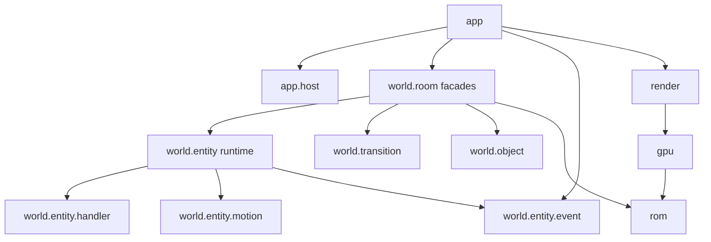

# Architecture

## Overview

This Java 21 / LWJGL engine reconstructs Link's Awakening DX for
preservation and research. Users provide their own ROM. ROMs and extracted
original assets must never enter commits, distributions, examples or fixtures.
Runtime graphics and world data come from that ROM.

The ROM and LADX disassembly are the technical sources of truth.
The simulation advances in 60 Hz frames and reconstructs ROM state machines,
rather than running a general Game Boy CPU emulator.
Byte-sized counters, slot ordering, intentional offsets and input edges are
observable behavior. A refactor must preserve them without behavior changes.
Replay checkpoints and emulator comparisons establish bounded fidelity;
a passing test suite does not establish game-wide parity.

`Main` is the entry point; `GameSession` owns a running session.
Hosts supply native input, presentation and PCM output. Headless execution
uses the same session simulation with a different host.
See [BUILDING.md](BUILDING.md) for setup and local ROM configuration.

## Package map

All names below are relative to `linksawakening` under
`java/src/main/java`. Subpackages own implementation responsibilities;
package placement does not imply that every pair is independent.

### `app`

Session composition, input routing, screen selection, saves and render-state assembly.
Key types: GameSession, SessionContext, SessionBootstrap, InputRouter, RenderStateAssembler.

`GameSession` owns the frame clock, run loop and headless entry points.
`SessionContext` is constructed once during initialization and wires the session.
It retains one final `SessionBootstrap.Collaborators` object containing the
ROM-backed services. The bootstrap snapshot validates its references at
construction; services are not copied into dozens of session fields.

`SceneState` owns the selected background maps and palettes. `ScreenState`
owns the current screen, file-menu/save controllers and selected save slot.
`DebugState` owns the no-clip flag and optional debug menu/overlay.
Configuration and save-store replacement remain live for integration tests.
The frame counter, opening motions and gameplay sound-sink bridge remain on
`GameSession` because external integration tests access those fields directly.
They are read at use time, not captured in a per-frame context record.

Input/screen routing, saves, render-state assembly, opening story and
bush/dialog/lift interactions are retained classes. Their accessors resolve
live session state; functional callbacks are initialized once. Nullable state
such as an inactive opening motion, closed menu or absent active sword remains
explicitly nullable. Construction-validated service references need no
per-frame null guards.

`HeadlessGameDriver.State` and `Diagnostics` are immutable snapshots with
record-style accessors and value operations, constructed from their owner
rather than long positional argument lists. The nine-argument
`FileMenuScreen.Dependencies` constructor remains a compatibility exception:
`MainFileMenuFlowTest` constructs it directly.

### `app.host`

Native lifecycle boundary and desktop/headless implementations.
Key types: Host, DesktopHost, HeadlessHost.

### `app.screen`

Screen lifecycle implementations for title, cutscene, file menus and gameplay.
Key types: Screen, GameplayScreen, TitleScreen.

### `app.gameplay`

Ordered gameplay orchestration and adaptation of world requests to Link commands.
Key types: GameplayFrame, GameplaySimulation, EntityPhase, LinkCommandAdapter.

`GameplaySimulation` and its phase instances are retained for the session
lifetime. `GameplayFrame` and `TransitionPhase` are also built once.
The owned phases read the simulation's live accessors directly, while
`EntityPhase` retains its existing accessor contract. `GameplayFrame.tick()`
makes three direct ordered calls; `Phase` and `phaseOrder()` remain the
architecture-test contract and are not used to allocate a dispatch list each
frame.

### `app.story`

Opening-story coordination and presentation gates.
Key types: OpeningStory.

### `audio`

Audio implementation namespace containing sequencing, synthesis and output components.
Key types: music, sfx, apu, openal, browser.

### `config`

Application configuration and launch preferences.
Key types: AppConfig.

### `cutscene`

Scripted intro sequence, cutscene lifecycle and ROM-backed intro data.
Key types: CutsceneManager, CutsceneScript, IntroSequence.

### `dialog`

Dialog state, ROM text layout, font and box rendering.
Key types: DialogController, DialogRomLayout, DialogRenderer.

### `entity`

Link state and motion, command application, and shared sprite definitions. Room entity simulation lives in world.entity.
Key types: Link, LinkCommand, LinkStateMachine, EntitySpriteCatalog.

### `equipment`

Equipped item behavior, activation and item sprite support.
Key types: EquipmentController, EquipmentItem, ItemRegistry, Sword.

### `gameplay`

Gameplay integration contracts, dialog interactions, sound routing and event consumers.
Key types: EnemyCombatEventConsumer, EnemyProjectileEventConsumer, PcmSoundOutput.

### `gpu`

VRAM, tile decoding, animation and named ROM tile loaders behind the GPU facade.
Key types: GPU, Vram, AnimatedTiles, RoomTileLoader.

### `input`

Input bindings and current/edge state.
Key types: InputConfig, InputState.

### `physics`

Room collision queries and physical flags.
Key types: OverworldCollision, PhysicsFlags.

### `render`

Frame scenes, indexed planes, OAM submission, hardware composition and GL presentation.
Key types: FrameScene, HardwareFrame, OamSink, OpenGlFramePresenter.

### `rom`

Typed ROM addresses, symbols, bank mapping and shared tables.
Key types: Rom, RomAddress, RomSymbols, GbcBanks.

### `save`

Save RAM layout, images, slots and persistence.
Key types: SaveRamStore, SaveRamImage, SaveSlotState.

### `scene`

ROM-backed background scene catalog and loading.
Key types: BackgroundSceneLoader, BackgroundSceneSpec.

### `startup`

New-game starting profile and wake-up/shield motion state machines.
Key types: StartupCoordinator, MarinWakeUpMotion, TarinShieldMotion.

### `state`

Player progression and Link-facing player state contract.
Key types: PlayerState, LinkPlayerState.

### `ui`

Inventory, HUD and file-menu controllers and overlays.
Key types: InventoryController, InventoryMenu, HudOverlay, FileMenuController.

### `vfx`

Transient visual effects and cut-leaf presentation.
Key types: TransientVfxSystem, TransientVfxSpriteSheet.

### `world`

World ownership namespace partitioned into rooms, transitions, objects and entities. No direct app dependency is allowed.
Key types: room, transition, object, entity.

### `world.room`

Room facade, decoded room state, loading, palettes, tilemaps, mutations and entity integration.
Key types: RoomSession, RoomSessionContext, RoomLoadCoordinator, RoomObjectMutations.

### `world.transition`

Boundary decisions, scrolling, warps and transition progression.
Key types: RoomBoundaryController, ScrollController, TransitionController, Warp.

### `world.object`

Object-specific interactions and switch-block behavior.
Key types: OverworldBushInteraction, BombObjectInteraction, SwitchBlockAnimation.

### `world.entity`

ROM slot simulation, lifecycle, collision, spawns, rewards and frame request production.
Key types: RoomEntityRuntime, RoomEntity, EntityFrameContext, EntityFrameExecution.

### `world.entity.handler`

Type and family dispatch implementations, internal to entity simulation. Handlers do not depend on world.room.
Key types: EntityHandlerFamilies, BombHandler, RoamingEnemyTypeHandler.

### `world.entity.motion`

Entity-specific motion and state-machine calculations, internal to entity simulation.
Key types: BombMotion, MoldormMotion, FollowingNpcMotion.

### `world.entity.event`

Value events and requests exchanged across the entity boundary.
Key types: EntityEvent, EntityRequest, DialogRequest, LinkFinalPositionRequest.

### Dependency boundaries

Arrows show permitted use across the principal boundaries, not every import.
The app uses an explicit world facade allow-list and event contracts.
Handlers and motion remain internal to world.entity.



`WorldDependencyTest` in `java/src/test/java/linksawakening/architecture`
reads compiled constant pools, including descriptors and generic signatures.
It rejects world-to-app references, handler-to-room references and external
use of motion/handlers, and checks the explicit app/world facade surface.
Event dependencies must be event contracts or record/enum values.
`MainArchitectureTest` in `java/src/test/java/linksawakening` checks session
ownership, gameplay call ordering and native dependency restrictions.
`GlBoundaryTest` in `java/src/test/java/linksawakening/render` scans compiled
gpu/render classes: only presenter classes may reference LWJGL there.
These are specific guardrails, not a universal acyclic-package rule.

## Frame lifecycle

`Host.pollEvents()` delivers keys to session input routing.
`GameSession.update()` advances the byte-sized frame counter and begins the
ROM random frame, then ticks `MusicDirector` before ticking the active screen.
Thus sound requests produced during simulation are sequenced after this
frame's audio advance; moving audio after entities changes timing.

For gameplay, `GameplayFrame` executes TRANSITIONS, SIMULATION and
INPUT_COMPLETION in that order. Simulation can return early at story gates;
normal completion still advances input edges. Exceptions do not advance them.
`GameplaySimulation` runs dialog/story, Link/equipment, combat, entities,
dialog gameplay cooldown and animated tiles in source order.
Scrolling, transitions and inventory state gate entity ticking.

The runtime iterates slots from highest index to zero. Each slot passes
`EntitySlotPhase1` through `EntitySlotPhase5`; a phase can end that slot's work.
Entity effects are consumed at the entity boundary, including projectiles,
combat, rewards, dialog and music requests. Link writes become `LinkCommand`
values through `LinkCommandAdapter` and are applied through `Link.apply`.
Competing Link writes retain descending source-slot ordering.

After simulation, `RenderStateAssembler` supplies frame state to scene
construction. Indexed layers and OAM entries feed hardware composition.
`FrameScene` composes RGBA, and the host presents the resulting pixels.
Headless stepping composes the framebuffer without a native window.
Package-private `GameSession.stepWithoutRender()` runs the same update,
including audio and input completion, without assembling/composing pixels.
`SessionAllocationTest` uses that path with 600 warm-up and 600 measured frames
and `ThreadMXBean` allocation counters. Its fixed total-step limits are 8 KiB
for the opening-dialog idle sample and 24 KiB for active gameplay after leaving
the bed. Both include audio and world work; neither claims isolated app-only
allocation. The active sample checks the normal-button bed-exit checkpoint.
JFR sampling identified world snapshot/outbox/puzzle streams and audio PCM
buffers as substantial remaining sources outside application composition.

```mermaid
sequenceDiagram
  participant H as Host
  participant S as GameSession
  participant A as MusicDirector
  participant G as GameplayFrame
  participant E as RoomEntityRuntime
  participant L as Link
  participant R as RenderStateAssembler / FrameScene
  H->>S: poll events / route input
  S->>A: tick audio
  S->>G: tick active gameplay screen
  G->>G: transitions
  G->>L: dialog/story then Link/equipment
  G->>G: combat
  G->>E: entity frame inputs
  loop descending slots
    E->>E: phases 1 through 5 / handler stages
  end
  E-->>G: outbox events and requests
  G->>L: adapt and apply LinkCommand
  G->>G: consume rewards/dialog/music; cooldown; tiles
  G->>G: complete input edges
  S->>R: assemble and compose hardware frame
  R-->>H: RGBA pixels for presentation
```

## Entity system

`RoomEntityRuntime` owns slot orchestration; `EntityRuntimeState` holds slot
arrays and room handler state. `RoomEntity` represents an occupied entity.
Slots preserve ROM identity and ordering; they are not an unordered collection.
Lifecycle and spawn helpers coordinate replacement and allocation.
Do not compact slots or sort entities by type during a refactor.

`EntityHandlerRegistry` dispatches on the ROM type byte with 256 bindings.
It supports initialization, advance functions and stage-specific handlers.
Duplicate registrations fail. Unregistered types remain explicitly unsupported.
`EntityHandlerFamilies` supplies family registrations; individual handlers
encode type-specific work without taking ownership of the room facade.

`EntityTickStage` names source dispatch sites, not ROM entity IDs.
Its phase-prefixed names distinguish repeated visits to the same type.
Actual call sites in the slot phases establish execution order; enum declaration
order alone is not the runtime schedule. Preserve early returns and repeated
stage visits when moving code between handlers.

`EntityFrameContext` is an immutable record of frame inputs: Link coordinates,
Z, direction, speeds, sword box, collision services, RNG and interaction gates.
Referenced services preserve their identity; the record does not make them pure.
`EntityFrameExecution` holds mutable execution locals for the current slot.
It exposes lifecycle/spawn services, slot replacement and typed emit methods.
Motion classes implement entity-specific progression while runtime orchestration
retains slot ownership and ordering.

Typed events and requests accumulate in the entity outbox rather than calling
app orchestration from handlers. Consumption bridges world effects into Link,
player progression, dialogs, music and transient effects.
A request's source slot matters when multiple handlers write Link in one frame.

To add an entity type:

1. Locate its ROM handler, tables, initialization and dispatch sites in the
   disassembly; record exact symbols and intentional offsets.
2. Trace an existing related family through `EntityHandlerFamilies`, registry
   registration and the relevant slot-phase calls.
3. Implement motion/state transitions in `world.entity.motion` and handler
   dispatch in `world.entity.handler`, preserving byte arithmetic and timers.
4. Register the type and every required stage; do not invent a stage order from
   type IDs or assume one handler invocation per frame.
5. Use frame collision/RNG services and lifecycle/spawn helpers. Emit typed
   events for cross-boundary effects instead of importing room or app classes.
6. Add the needed consumption at the room/app entity boundary and adapt Link
   writes through commands with the existing source-slot merge semantics.
7. Supply ROM-backed sprite/table reads and verify palette, animation and
   placement against the original loaders rather than exported assets.
8. Add focused synthetic/unit coverage and ROM integration coverage where
   required, then replay and compare the affected route against the emulator.

## Rooms and world

`world.room.RoomSession` is the public room API. It delegates to room-scoped
collaborators instead of exposing entity handlers to application code.
`RoomSessionContext` collects room dependencies and state.
`RoomWorldState`, `RoomTransientState` and `RoomStoryState` separate persistent
world concerns, transient state and story progression.
`ActiveRoom` and `RoomRenderSnapshot` provide room information to consumers.

`RoomLoadCoordinator` coordinates room loading; `RoomLoader` reads room streams,
`RoomObjectParser` decodes objects, and `RoomTilemapBuilder` constructs tilemaps.
`RoomPaletteLoader` owns palette decoding. Pointer tables and tileset tables
retain bank/page selection rather than flattening ROM addressing.
See [ROM_FORMAT_NOTES.md](ROM_FORMAT_NOTES.md) for stream and macro details.

`RoomTransitionCoordinator` and room transition collaborators connect room
changes to scrolling and transition state. `world.transition` owns boundary
and warp mechanics. Keep load timing, input blocking and transition progress
intact: a visually plausible destination alone does not verify a transition.

`RoomObjectMutations` and room redraw helpers coordinate object changes with
room representation. Door, puzzle and player-item collaborators implement
specific interactions; `world.object` contains object-specific behavior.
Entity integration passes through room bridges, inputs and reward handling.
Changing a visual tile alone is insufficient when collision or persistent room
status also changes.

## Rendering

[RENDERING.md](RENDERING.md) is the detailed compositor contract.
Software layers submit indexed BG/window pixels and OBJ entries.
`GPU` is a facade over VRAM, animation and ROM tile loaders.
`OpenGlFramePresenter` owns GL presentation; gameplay does not issue GL calls.
Hardware composition is the production default and produces RGBA once.

CGB OBJ-to-background/window composition uses color-zero transparency,
both priority flags and LCDC bit 0. OBJ-to-OBJ ordering currently retains the
emulator-validated legacy painter order. It does not yet implement the ROM's
dynamic OAM allocator. An 8x16 entry retains its original Y for both halves.
Dialog and inventory hiding operate on whole entries using ROM visibility rules.

The parity harness compares hardware output to a test-only RGBA reference.
Strict parity rejects unexplained differences; expected fixes require narrow
source and pixel evidence. Independent emulator fixtures remain necessary
because two engine implementations can share a mistake.
`RenderPipelineParityTest` and `SceneParityExtension` produce local reports in
`java/build/scene-parity`; `-PsceneParityProbe=true` records mismatch groups.
ROM-derived screenshots and reports containing assets remain local.

## Audio

See [audio-engine-guide.md](audio-engine-guide.md) for sequencing and synthesis.
Music and SFX drivers consume ROM data and write APU registers.
`GameBoyApu` synthesizes deterministic stereo PCM; output owns host playback.
The `audio.music`, `audio.sfx` and `audio.apu` subpackages keep these duties apart.
`audio.openal` provides native playback and `audio.browser` the Swing audition UI.

The session uses `FrameAudioPlayer` with host-created `PcmSoundOutput`.
`MusicDirector.tick()` advances it once per game frame. Sample remainders
preserve long-term sample totals. Dialog and gameplay effect routing share the
ROM-backed SFX driver/APU path with music. Headless output discards PCM.
The session closes its output resources.

The independent browser retains `OpenAlMusicPlayer` and sample-driven buffering.
Its transport is not the gameplay frame clock. Native audio is unnecessary for
pure driver/APU tests. The guide's early music-first scope summary predates
session gameplay integration described in its final section.

## ROM access

`RomSymbols` provides generated exact-label addresses. Regeneration uses a
locally built RGBDS symbol file; normal builds do not require the disassembly.
`Rom` is a read-only view of caller-owned bytes: callers preserve the backing
array, while `slice` returns a copy. Prefer typed `u8`, `u16le` and slice reads.
`RomAddress` centralizes bank-window/file-offset conversion and advancement.

`GbcBanks.adjust` mirrors the ROM's bank adjustment explicitly at loader call
sites. Do not apply a global adjustment to every symbol.
Retain bounds checks at format boundaries and exact-label verification.
[ROM_SYMBOLS.md](ROM_SYMBOLS.md) records migrations and address evidence.
Its historical declaration counts are checkpoints, not a current package audit.

`WorldRomConstantGuardTest` in `java/src/test/java/linksawakening/rom` guards
owned sources against raw ROM location patterns; read its covered surface
before extending it. `RomAddressTest`, `RomBankTest` and `RomTablesTest` cover
address/table behavior. Guard success does not prove semantic loader fidelity.

## Testing and verification

Run commands from `java/` with the checked-in Gradle wrapper and JDK 21.
`./gradlew romFreeTest` keeps development possible without original game data.
Unit tests use synthetic data for focused behavior and deterministic boundaries.
Compiled architecture guards check dependencies and selected ordering contracts.

ROM integration classes use `@RequiresRom` and `TestRom.open()`.
The annotation tags and skips integration tests when the ROM is absent;
TestRom enforces annotation use. Never add ROM fixtures to make CI pass.
`./gradlew test` includes integration tests when a local ROM is available.

Opening-route replay and comparison tools live under `tools/opening`;
intro, menu, house and dialog tools cover their corresponding slices.
Follow [BUILDING.md](BUILDING.md) for dependencies and CLI help.
Capture route hashes, checkpoints, comparison regions and remaining mismatches.
Use render parity alongside emulator comparison, not as a substitute for it.
Dated evidence is indexed in [README.md](README.md).

`.github/workflows/ci.yml` runs on pull requests targeting `main` only.
Its Ubuntu/macOS matrix uses Java 21 and runs
`./gradlew classes romFreeTest distZip -PallPlatforms`.
Failure artifacts include test reports and results. CI does not supply a ROM
or establish gameplay parity.

## Known limitations and future work

A future `RomOamAllocator` must reconstruct dynamic ROM allocation before
switching to actual CGB lower-OAM-index OBJ priority. Static Link/sword slots
cannot establish equivalent ordering.

The browser's sample-driven audio transport remains separate from gameplay.
Audio driver reconstruction is not CPU-level execution of all original routines,
and analog filtering/speaker coloration are not a claim of this architecture.

Read the Unverified notes in [ROM_FORMAT_NOTES.md](ROM_FORMAT_NOTES.md) and
[reconstruction-roadmap.md](reconstruction-roadmap.md) before extending scope.
Verified routes and compositor regions establish only their documented slice.
Historical plans are evidence of intent, not requirements already implemented.
