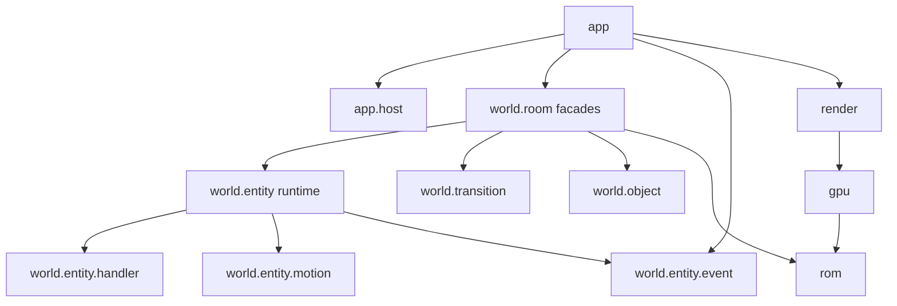

# Architecture

## Overview

This Java 21 / LWJGL engine reconstructs Link's Awakening DX for
preservation and research. Users provide their own ROM. ROMs and extracted
original assets must never enter commits, distributions, examples or fixtures.
Runtime graphics and world data come from that ROM.

The ROM and LADX disassembly are the technical sources of truth.
The simulation advances in 60 Hz frames and reconstructs ROM state machines,
rather than running a general Game Boy CPU emulator.
Byte-sized counters, slot ordering, intentional offsets and input edges are
observable behavior. A refactor must preserve them without behavior changes.
Replay checkpoints and emulator comparisons establish bounded fidelity;
a passing test suite does not establish game-wide parity.

`Main` is the entry point; `GameSession` owns a running session.
Hosts supply native input, presentation and PCM output. Headless execution
uses the same session simulation with a different host.
See [BUILDING.md](BUILDING.md) for setup and local ROM configuration.

## Package map

All names below are relative to `linksawakening` under
`java/src/main/java`. Subpackages own implementation responsibilities;
package placement does not imply that every pair is independent.

### `app`

Session composition, input routing, screen selection, saves and render-state assembly.
Key types: GameSession, SessionContext, SessionBootstrap, InputRouter, RenderStateAssembler.

`GameSession` owns the frame clock, run loop and headless entry points.
`SessionContext` is constructed once during initialization and wires the session.
It retains one final `SessionBootstrap.Collaborators` object containing the
ROM-backed services. The bootstrap snapshot validates its references at
construction; services are not copied into dozens of session fields.

`SceneState` owns the selected background maps and palettes. `ScreenState`
owns the current screen, file-menu/save controllers and selected save slot.
`DebugState` owns the no-clip flag and optional debug menu/overlay.
Configuration and save-store replacement remain live for integration tests.
The frame counter, opening motions and gameplay sound-sink bridge remain on
`GameSession` because external integration tests access those fields directly.
They are read at use time, not captured in a per-frame context record.

Input/screen routing, saves, render-state assembly, opening story and
bush/dialog/lift interactions are retained classes. Their accessors resolve
live session state; functional callbacks are initialized once. Nullable state
such as an inactive opening motion, closed menu or absent active sword remains
explicitly nullable. Construction-validated service references need no
per-frame null guards.

`HeadlessGameDriver.State` and `Diagnostics` are immutable snapshots with
record-style accessors and value operations, constructed from their owner
rather than long positional argument lists. The nine-argument
`FileMenuScreen.Dependencies` constructor remains a compatibility exception:
`MainFileMenuFlowTest` constructs it directly.

### `app.host`

Native lifecycle boundary and desktop/headless implementations.
Key types: Host, DesktopHost, HeadlessHost.

### `app.screen`

Screen lifecycle implementations for title, cutscene, file menus and gameplay.
Key types: Screen, GameplayScreen, TitleScreen.

### `app.gameplay`

Ordered gameplay orchestration and adaptation of world requests to Link commands.
Key types: GameplayFrame, GameplaySimulation, EntityPhase, LinkCommandAdapter.

`GameplaySimulation` and its phase instances are retained for the session
lifetime. `GameplayFrame` and `TransitionPhase` are also built once.
The owned phases read the simulation's live accessors directly, while
`EntityPhase` retains its existing accessor contract. `GameplayFrame.tick()`
makes three direct ordered calls; `Phase` and `phaseOrder()` remain the
architecture-test contract and are not used to allocate a dispatch list each
frame.

### `app.story`

Opening-story coordination and presentation gates.
Key types: OpeningStory.

### `audio`

ROM sequencing, deterministic synthesis, pure sample transport and host output.
Only `audio.openal` may reference LWJGL. Browser models are headless.
Key types: MusicDriver, MusicVoiceEmitter, GameBoyApu, FrameAudioMixer, OpenAlStream.

### `config`

Application configuration and launch preferences through a strict JSON reader.
Malformed JSON fails with a source position; no JSON dependency is required.
Key types: AppConfig, MiniJson.

### `cutscene`

Scripted intro sequence, cutscene lifecycle and ROM-backed intro data.
Key types: CutsceneManager, CutsceneScript, IntroSequence, IntroSequenceState.

The intro retains one state instance and one RNG. Lifecycle, scene motion,
beach motion, transitions and rendering are bounded implementation sections
sharing that state through the internal class hierarchy. Public IntroSequence
constructors and constants remain the entry points. Published frame snapshots
retain their immutable copies. Publishers reuse named snapshot builders; the
record constructors remain deprecated compatibility entry points.

### `dialog`

Dialog state, ROM text layout, font and box rendering.
Key types: DialogController, DialogState, DialogLifecycle, DialogPaging,
DialogTextFormatting, DialogRomLayout, DialogRenderer.

The controller's internal sections share one dialog state, preserving input
edges, reveal timing, page scrolling, choice selection and sound ordering.
The public controller and nested value types retain their existing names.

### `entity`

Link composition, motion, command application and shared sprite definitions.
Room entity simulation lives in world.entity.
Key types: Link, LinkAssembly, LinkPosition, LinkAnimationState, LinkItemState,
LinkGroundMotion, LinkSignals, LinkRecovery, EntitySpriteCatalog.

Link exposes the existing API through bounded compatibility views. Components
own their position, animation, timers and status fields. Each behavior receives
only its declared peer dependencies through typed assembly cells; no behavior
retains Link. LinkAssembly binds the cyclic graph once before publishing the
instance. LinkServices and the aggregate's component references are final.
Position, collision, jumping, scripted poses and motion lifecycle use bounded
implementation sections sharing their respective component's state.

LinkFrameMotion keeps ordered frame phases and a retained working-value holder.
Direction conversions explicitly distinguish Java indices, ROM indices and
legacy invalid-input fallbacks. Public integer constants remain deprecated
constant expressions for external switch compatibility.

Entity sprite registrations are short source-ordered groups, separate from
lookup, dynamic/boss compositions and ROM decoding. The decoder owns one ROM
view. LinkComponentOwnershipTest guards against facade back-references.

### `equipment`

Equipped item behavior, activation and item sprite support.
Key types: EquipmentController, EquipmentItem, ItemRegistry, Sword,
SwordState, SwordAttackMotion, SwordChargeMotion.

Sword implementation sections retain one attack/charge state. Equipment tick
dispatch uses primitive frame counters with an explicit presence flag, retaining
held/edge ordering without boxed per-frame counters. Inventory classification
uses state.InventoryItem; raw inventory bytes still address the registry.

### `gameplay`

Gameplay integration contracts, dialog interactions, sound routing and event consumers.
Key types: EnemyCombatEventConsumer, EnemyProjectileEventConsumer, PcmSoundOutput.

Owned consumers address focused PlayerState components. The sound boundary
adapts resource requests to presentation events; the old PlayerState sound
return type remains an isolated deprecated compatibility bridge. Signpost
interaction has a named argument bundle alongside its legacy long signature.

### `gpu`

VRAM, tile decoding, animation and named ROM tile loaders behind the GPU facade.
Key types: GPU, Vram, AnimatedTiles, RoomTileLoader.

### `input`

Native-free bindings and held/edge state with stable numeric engine key codes.
DesktopHost translates GLFW actions at the callback boundary; edge ordering is unchanged.
Key types: InputConfig, InputState, KeyCodes.

### `physics`

Room collision queries and physical flags.
Key types: OverworldCollision, PhysicsFlags.

Physics remains input-free. StateDependencyTest scans this package for input
dependencies as well as checking the player-state boundary.

### `render`

Frame scenes, indexed planes, OAM submission, hardware composition and GL presentation.
Key types: FrameScene, HardwareFrame, OamSink, OpenGlFramePresenter.

### `rom`

Typed ROM addresses, symbols, bank mapping and shared tables.
Key types: Rom, RomAddress, RomSymbols, GbcBanks.

### `save`

Source-shaped SRAM layout, image operations, player-field codec and host persistence.
Wrong-sized saves are copied to timestamped corrupt backups before initialization.
Persistence writes a complete temporary image then replaces the destination atomically
where supported, with a replacement-move fallback.
Key types: SaveRamStore, SaveRamLayout, SaveRamImage, SaveSlotCodec, SaveSlotState.

### `scene`

ROM-backed background scene catalog and loading.
Key types: BackgroundSceneLoader, BackgroundSceneSpec, BackgroundSceneCatalog.

Scene loading supplies decoded ROM-backed backgrounds to the intro and menus;
those controllers own their presentation state and snapshots.

### `startup`

New-game starting profile and wake-up/shield motion state machines.
Key types: StartupCoordinator, NewGameStartProfile, MarinWakeUpMotion, TarinShieldMotion.

Startup uses focused player initialization and equipment state operations while
retaining the source-shaped opening-motion timers and presentation contracts.
NewGameStartProfile also offers a named builder alongside its canonical constructor.

### `state`

Player resources, progression, ROM value types and the Link-facing state contract.
Key types: PlayerState, LinkPlayerState, Inventory, Vitals, Ammunition, Progression,
EquipmentLevels, Wallet, Direction, InventoryItem, Tunic, PowerUp, OcarinaSong.

PlayerState is the aggregate; deprecated compatibility sections forward old
methods to the owning components. PlayerInitialization and PlayerSaveLoader
preserve ordered initialization and load writes, including saved ammunition
above ordinary pickup capacity. PlayerRewards and ChestRewards apply primitive
reward values without importing world. Raw unknown inventory bytes survive
classification and save round trips.

Resource sounds use a single last-write-wins ResourceSound value. The legacy
GameplaySoundEvent return type is confined to one deprecated bridge in
PlayerResourceCompatibility. StateDependencyTest allows only state, rom and
save dependencies outside that method, and rejects world imports entirely.
Player components have focused boundary tests; reusable test builders provide
named player and Link setup without hidden ROM loading.

### `ui`

Inventory, HUD and file-menu controllers and overlays.
Key types: InventoryController, InventoryMenu, HudOverlay, FileMenuController,
FileMenuState, FileMenuFlow, FileMenuEditing, TilemapRenderer.

File-menu implementation sections share one state instance. Inventory rendering
retains row buffers and mutable call arguments consumed synchronously by the
renderer. TilemapRenderer.Region groups geometry; legacy long signatures remain
deprecated bridges. Public frame snapshots retain immutable ownership and use retained builders.
OcarinaSong defines the flag-to-selection-index mapping used by the song menu.

### `vfx`

Transient visual effects and cut-leaf presentation.
Key types: TransientVfxSystem, TransientVfxSpriteSheet, CutLeavesEffectRenderer.

Slot collection uses an ordered loop without per-call stream/lambda allocation.
Returned slot and sprite-placement snapshots retain their immutable semantics.

### `world`

World ownership namespace partitioned into rooms, transitions, objects and entities. No direct app dependency is allowed.
Key types: room, transition, object, entity.

### `world.room`

Room facade, decoded room state, loading, palettes, tilemaps, mutations and entity integration.
Key types: RoomSession, RoomSessionContext, RoomLoadCoordinator, RoomObjectMutations.

### `world.transition`

Boundary decisions, scrolling, warps and transition progression.
Key types: RoomBoundaryController, ScrollController, TransitionController, Warp.

### `world.object`

Object-specific interactions and switch-block behavior.
Key types: OverworldBushInteraction, BombObjectInteraction, SwitchBlockAnimation.

### `world.entity`

ROM slot orchestration, owned state, scoped controller services, collision and frame requests.
Key types: RoomEntityRuntime, EntityMotionRegistry, EntityPhysicsTables, EntityCombatTables, EntityFrameExecution.

### `world.entity.handler`

Explicit type registration and ordered dispatch-site callbacks, internal to entity simulation. Handlers do not depend on world.room.
Key types: EntityHandlerFamilies, BombHandler, RoamingEnemyTypeHandler.

### `world.entity.motion`

Entity-owned slot state and state-machine calculations, acquired through the typed motion registry.
Key types: BombMotion, MoldormMotion, FollowingNpcMotion.

### `world.entity.event`

Value events and requests exchanged across the entity boundary.
Key types: EntityEvent, EntityRequest, EntityCombatEventBuilder, DialogRequest, LinkFinalPositionRequest.

### Dependency boundaries

Arrows show permitted use across the principal boundaries, not every import.
The app uses an explicit world facade allow-list and event contracts.
Handlers and motion remain internal to world.entity.



`WorldDependencyTest` in `java/src/test/java/linksawakening/architecture`
reads compiled constant pools, including descriptors and generic signatures.
It rejects world-to-app references, handler-to-room references and external
use of motion/handlers, and checks the explicit app/world facade surface.
Event dependencies must be event contracts or record/enum values.
`MainArchitectureTest` in `java/src/test/java/linksawakening` checks session
ownership, gameplay call ordering and native dependency restrictions.
`GlBoundaryTest` in `java/src/test/java/linksawakening/render` scans compiled
gpu/render classes: only presenter classes may reference LWJGL there.
These are specific guardrails, not a universal acyclic-package rule.

## Frame lifecycle

`Host.pollEvents()` delivers keys to session input routing.
`GameSession.update()` advances the byte-sized frame counter and begins the
ROM random frame, then ticks `MusicDirector` before ticking the active screen.
Thus sound requests produced during simulation are sequenced after this
frame's audio advance; moving audio after entities changes timing.

For gameplay, `GameplayFrame` executes TRANSITIONS, SIMULATION and
INPUT_COMPLETION in that order. Simulation can return early at story gates;
normal completion still advances input edges. Exceptions do not advance them.
`GameplaySimulation` runs dialog/story, Link/equipment, combat, entities,
dialog gameplay cooldown and animated tiles in source order.
Scrolling, transitions and inventory state gate entity ticking.

The runtime iterates slots from highest index to zero. Each slot passes
`EntitySlotPhase1` through `EntitySlotPhase5`; a phase can end that slot's work.
`EntityPhase` builds immutable `EntityFrameInputs` from Link, player,
UI, buttons and sword-box snapshots through `EntityFrameInputsFactory`.
`LinkWriteApplier` applies ordered Link effects while `EntityPhase` orchestrates
rewards, combat and presentation. `RoomSession.tickEntities` applies those
inputs in the original setter order before advancing entity slots.
`EntityTickInputs` is the tick-only boundary for callers that retain cached
inputs; combat and pickup boundaries use their own parameter objects.
Entity effects are consumed at the entity boundary, including projectiles,
combat, rewards, dialog and music requests. Link writes become `LinkCommand`
values through `LinkCommandAdapter` and are applied through `Link.apply`.
Competing Link writes retain descending source-slot ordering. `RoomLinkWrites`
merges position streams with pot/platform/final-position tie precedence and
attack streams with attack-step precedence on ties. These are separate
consumption stages: a platform write can load a room before later outputs
are drained. `EntityFrameResults` groups live outbox views by Link, rewards
and presentation; it deliberately does not eagerly snapshot every channel.

After simulation, `RenderStateAssembler` supplies frame state to scene
construction. Indexed layers and OAM entries feed hardware composition.
`FrameScene` composes RGBA, and the host presents the resulting pixels.
Headless stepping composes the framebuffer without a native window.
Package-private `GameSession.stepWithoutRender()` runs the same update,
including audio and input completion, without assembling/composing pixels.
`SessionAllocationTest` uses that path with 600 warm-up and 600 measured frames
and `ThreadMXBean` allocation counters. Its fixed total-step limits are 8 KiB
for the opening-dialog idle sample and 24 KiB for active gameplay after leaving
the bed. Both include audio and world work; neither claims isolated app-only
allocation. The active sample checks the normal-button bed-exit checkpoint.
JFR sampling identified world snapshot/outbox/puzzle streams and audio PCM
buffers as substantial remaining sources outside application composition.

```mermaid
sequenceDiagram
  participant H as Host
  participant S as GameSession
  participant A as MusicDirector
  participant G as GameplayFrame
  participant E as RoomEntityRuntime
  participant L as Link
  participant R as RenderStateAssembler / FrameScene
  H->>S: poll events / route input
  S->>A: tick audio
  S->>G: tick active gameplay screen
  G->>G: transitions
  G->>L: dialog/story then Link/equipment
  G->>G: combat
  G->>E: entity frame inputs
  loop descending slots
    E->>E: phases 1 through 5 / handler stages
  end
  E-->>G: outbox events and requests
  G->>L: adapt and apply LinkCommand
  G->>G: consume rewards/dialog/music; cooldown; tiles
  G->>G: complete input edges
  S->>R: assemble and compose hardware frame
  R-->>H: RGBA pixels for presentation
```

## Entity system

`RoomEntityRuntime` is the source-compatible room facade. It contains an
`EntityRuntimeState`; neither class inherits fields or constants. The state
composition has nine references, including four cohesive stores:
`EntityPhysicsTables`, `EntityCombatTables`, `EntityRoomVariables` and
`EntityPresentationState`. Their fields are private and accessed through slot
or room methods. `EntityRomConstants` is a final, non-instantiable holder; the
one deprecated facade alias remains for `RoomEntityBridge`.

Per-type state belongs to its motion or controller: for example Iron Mask,
Moldorm, Rolling Bones and Moblin King retain their own slot latches, Genie
owns its jar/body/projectile coordination, and the story controller owns owl
state. `EntityMotionRegistry` lazily supplies one typed motion instance per
room through `get(MotionClass.class, MotionClass::new)`. Adding a motion does
not add a field to central runtime state. Controllers receive narrowly scoped
service interfaces; bindings connect those capabilities to the room facade.
Stateless behavior helpers operate on their owner's state. Longer operations
use private, per-invocation scratch and named state handlers; persistent slot
state never lives in those invocation objects.

`EntitySlotOrchestrator` runs the five slot phases in descending slot order.
`RoomEntity` is an immutable snapshot whose slot and load order are ROM
identity. Lifecycle and spawn helpers preserve allocation, reset and early
return sites. Do not compact slots, sort by type, add resets on slot reuse or
move RNG reads and byte writes across their original execution points.

`EntityHandlerRegistry` has 256 type bindings for initialization, generic
advance and stage hooks. Handlers register explicit type IDs and named static
callbacks. Their initializer and advance registrations live beside their tick
hooks. `EntityHandlerFamilies.INSTALLERS` is the ordered installation list;
duplicate registrations fail and unsupported bindings remain explicit.

`EntityTickStage` describes 27 dispatch sites between the phase operations.
Each site retains ordered visit positions, preserving all 141 original visits.
Dispatch reads the current slot type at each visit, so an earlier hook that
replaces or transforms an entity affects subsequent selection exactly as
before. A false callback stops the slot immediately. Site names and visit
positions describe source order; enum order and numeric entity IDs do not
establish the schedule.

`EntityFrameContext` is immutable frame input. Use its builder or `toBuilder`
when changing Link state, collision services, RNG or interaction gates; service
references retain their identity. `EntityFrameExecution` exposes operations,
not public mutable fields. Its private scratch is grouped into frame inputs,
timer gates, slot execution and presentation flags. Frame setup and commit
remain separate from individual handler behavior.

Typed events and requests accumulate in the entity outbox rather than calling
app orchestration from handlers. Room/app consumers apply Link, progression,
dialog, music and transient effects. Source slots preserve the order of
multiple Link writes in a frame. `EntityCombatEvent.builder` names optional
combat effects without positional argument lists.

Use `RoomEntityRuntime.builder(snapshot)` for runtime construction. Test-side
`EntityRuntimeFixture`, inspection fixtures and `RoomEntityBuilder` provide
setup and queries without production test hooks. Runtime tests are split by
entity family and behavior. Three deprecated `ForTest` delegates remain only
for `world.room.RoomSessionViews`; the externally used `from` overloads, frame
constructor and combat/follower adapters also remain deprecated. Immutable
record schemas retain their canonical constructor signatures and validation
for source compatibility; these value schemas are the exception to the
normal eight-parameter method limit.

To add an entity type:

1. Add its motion/state owner in `world.entity.motion`, using the disassembly's
   exact initialization, timers, byte arithmetic and RNG ordering.
2. Add its handler in `world.entity.handler`. Register initialization, advance
   and the required site/visit hooks there, acquire its motion through the
   typed registry, and emit typed events for effects outside the entity tree.
3. Add one `NewEntityHandler::install` entry to
   `EntityHandlerFamilies.INSTALLERS`.

Add focused behavior coverage using the test fixtures and ROM-backed tables;
never add extracted assets. For this refactor the required headless oracle is
`LA_ROM=/path/to/user/rom ./gradlew spotlessApply test` from `java/`, including
its default session replays. Explicitly tagged `known-gap` routes are excluded
from that suite and are not refactor validation targets. Preserve existing
consumer and sprite contracts when implementing a handler within the current
entity boundary.

## Rooms and world

`world.room.RoomSession` is the public room API. It delegates to room-scoped
collaborators instead of exposing entity handlers to application code.
The `doors()`, `transitions()`, `playerItems()`, `story()`, `entities()`,
`entityState()`, `rooms()`, `dungeon()`, `progress()` and `terrain()` views expose
focused role interfaces. Deprecated compatibility interfaces retain the old
facade entry points; the migration table is in
[room-facade-migration.md](history/room-facade-migration.md). View implementations
receive only their specific collaborators and state.
`RoomSessionContext` is private construction-time wiring. Runtime collaborators
receive their own dependency records and typed state: location, terrain,
followers, entity-frame state, item use and puzzles. No runtime collaborator
reads through the composition root. Typed service suppliers defer cyclic
room references until the room is wired.
`RoomWorldState`, `RoomTransientState` and `RoomStoryState` separate persistent
world concerns, transient state and story progression.
`ActiveRoom` and `RoomRenderSnapshot` provide room information to consumers.

`RoomLoadCoordinator` coordinates room loading; `RoomLoader` reads room streams,
`RoomObjectParser` decodes objects, and `RoomTilemapBuilder` constructs tilemaps.
`RoomPaletteLoader` owns palette decoding. Pointer tables and tileset tables
retain bank/page selection rather than flattening ROM addressing.
See [ROM_FORMAT_NOTES.md](ROM_FORMAT_NOTES.md) for stream and macro details.

`RoomTransitionCoordinator` and room transition collaborators connect room
changes to scrolling and transition state. `world.transition` owns boundary
and warp mechanics. Keep load timing, input blocking and transition progress
intact: a visually plausible destination alone does not verify a transition.

`RoomObjectMutations` and room redraw helpers coordinate object changes with
room representation. Door, puzzle and player-item collaborators implement
specific interactions; `world.object` contains object-specific behavior.
Entity integration passes through room bridges, inputs and reward handling.
`RoomEntityBridge` coordinates ticking; `RoomEntityFrameSetup` configures
the runtime, `RoomEntityAfterTick` applies ordered room effects,
`RoomEntityCombatBridge` handles combat/pickup integration and
`RoomEntityOutbox` owns queued outputs. The outbox uses a runtime supplier
because loading a room replaces the runtime.
Changing a visual tile alone is insufficient when collision or persistent room
status also changes.

## Rendering

[RENDERING.md](RENDERING.md) is the detailed compositor contract.
Software layers submit indexed BG/window pixels and OBJ entries.
`GPU` is a facade over VRAM, animation and ROM tile loaders.
`OpenGlFramePresenter` owns GL presentation; gameplay does not issue GL calls.
Hardware-only `FrameScene` composition produces RGBA once. Optional completed-frame
observers attach explicitly through the draw overload or session-local builder;
production performs no service lookup. RGBA callback scenes live in tests.

CGB OBJ-to-background/window composition uses color-zero transparency,
both priority flags and LCDC bit 0. OBJ-to-OBJ ordering currently retains the
emulator-validated legacy painter order. It does not yet implement the ROM's
dynamic OAM allocator. An 8x16 entry retains its original Y for both halves.
Dialog and inventory hiding operate on whole entries using ROM visibility rules.

The parity harness compares hardware output to a test-only RGBA reference.
Strict parity rejects unexplained differences; expected fixes require narrow
source and pixel evidence. Independent emulator fixtures remain necessary
because two engine implementations can share a mistake.
`RenderPipelineParityTest` and `SceneParityExtension` produce local reports in
`java/build/scene-parity`; `-PsceneParityProbe=true` records mismatch groups.
ROM-derived screenshots and reports containing assets remain local.

## Audio

See [audio-engine-guide.md](audio-engine-guide.md) for sequencing and synthesis.
Music and SFX drivers consume ROM data and write APU registers.
`GameBoyApu` synthesizes deterministic stereo PCM; output owns host playback.
The `audio.music`, `audio.sfx` and `audio.apu` subpackages keep these duties apart.
`audio.openal` provides native playback and `audio.browser` the Swing audition UI.

The session uses `FrameAudioPlayer` with host-created `PcmSoundOutput`.
`MusicDirector.tick()` advances it once per game frame. Sample remainders
preserve long-term sample totals. Dialog and gameplay effect routing share the
ROM-backed SFX driver/APU path with music. Headless output discards PCM.
The session closes its output resources.

The independent browser retains `OpenAlMusicPlayer` and sample-driven buffering.
Its transport is not the gameplay frame clock. Native audio is unnecessary for
pure driver/APU tests. The guide's early music-first scope summary predates
session gameplay integration described in its final section.

## ROM access

`RomSymbols` provides generated exact-label addresses. Regeneration uses a
locally built RGBDS symbol file; normal builds do not require the disassembly.
`Rom` is a read-only view of caller-owned bytes: callers preserve the backing
array, while `slice` returns a copy. Prefer typed `u8`, `u16le` and slice reads.
`RomAddress` centralizes bank-window/file-offset conversion and advancement.

`GbcBanks.adjust` mirrors the ROM's bank adjustment explicitly at loader call
sites. Do not apply a global adjustment to every symbol.
Retain bounds checks at format boundaries and exact-label verification.
[ROM_SYMBOLS.md](ROM_SYMBOLS.md) records migrations and address evidence.
Its historical declaration counts are checkpoints, not a current package audit.

`WorldRomConstantGuardTest` in `java/src/test/java/linksawakening/rom` guards
owned sources against raw ROM location patterns; read its covered surface
before extending it. `RomAddressTest`, `RomBankTest` and `RomTablesTest` cover
address/table behavior. Guard success does not prove semantic loader fidelity.

## Testing and verification

Run commands from `java/` with the checked-in Gradle wrapper and JDK 21.
`./gradlew romFreeTest` keeps development possible without original game data.
Unit tests use synthetic data for focused behavior and deterministic boundaries.
Compiled architecture guards check dependencies and selected ordering contracts.

ROM integration classes use `@RequiresRom` and `TestRom.open()`.
The annotation tags and skips integration tests when the ROM is absent;
TestRom enforces annotation use. Never add ROM fixtures to make CI pass.
`./gradlew test` includes integration tests when a local ROM is available.

Opening-route replay and comparison tools live under `tools/opening`;
intro, menu, house and dialog tools cover their corresponding slices.
Follow [BUILDING.md](BUILDING.md) for dependencies and CLI help.
Capture route hashes, checkpoints, comparison regions and remaining mismatches.
Use render parity alongside emulator comparison, not as a substitute for it.
Dated evidence is indexed in [README.md](README.md).

`.github/workflows/ci.yml` runs on pull requests targeting `main` only.
Its Ubuntu/macOS matrix uses Java 21 and runs
`./gradlew spotlessCheck classes romFreeTest distZip -PallPlatforms`.
Wrapper validation and ROM-free Python lint/unit checks accompany the Java jobs.
Failure artifacts include test reports and results. CI does not supply a ROM
or establish gameplay parity.

## Known limitations and future work

A future `RomOamAllocator` must reconstruct dynamic ROM allocation before
switching to actual CGB lower-OAM-index OBJ priority. Static Link/sword slots
cannot establish equivalent ordering.

The browser's sample-driven audio transport remains separate from gameplay.
Audio driver reconstruction is not CPU-level execution of all original routines,
and analog filtering/speaker coloration are not a claim of this architecture.

Read the Unverified notes in [ROM_FORMAT_NOTES.md](ROM_FORMAT_NOTES.md) and
[reconstruction-roadmap.md](reconstruction-roadmap.md) before extending scope.
Verified routes and compositor regions establish only their documented slice.
Historical plans are evidence of intent, not requirements already implemented.
